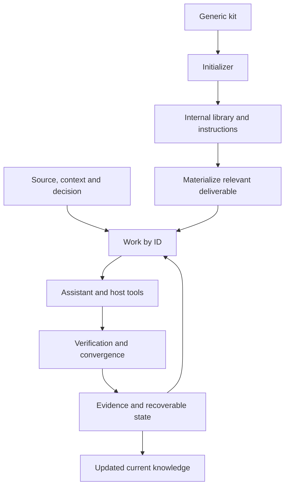
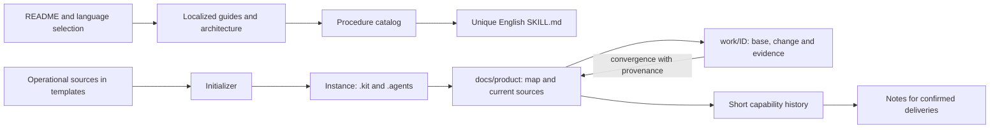
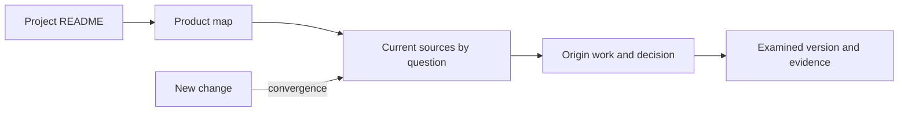

<!-- docs-nav:start -->
English · [Português (Brasil)](../pt-BR/ARCHITECTURE.md)

[Home](../../README.md) · [Documentation index](README.md)
<!-- docs-nav:end -->

# Local kit 0.1.0 architecture

The kit is a file-based assisted method with deterministic helpers.

| Layer | Content and responsibility |
|---|---|
| Distribution | Generic templates/, scripts/, license and documentation |
| Instance instructions | AGENTS, eleven skills, workflows, contracts, organization and cycles |
| Internal library | .kit/templates and catalog; materialization without overwriting |
| Project memory | Current feature pages, context, decisions and shared contracts |
| Identified delivery | docs/product/work/ID: brief, state, handoff and relevant artifacts |
| Verification | Owner and stage tools examine content/results; helpers check structure/hash |

There is no daemon, new-session executor, database, synchronizer or external framework. JSON state does not replace content documents. A hash identifies an evidence version without establishing truth. .kit/scripts travels with the instance; helpers need PowerShell 7.2+. The framework has no Python/Node dependency. Product runtime, web access and rendering depend on the requested work.

## Organization and teamwork

Foundations by discipline hold shared knowledge, authored on demand. Identified work isolates questions/changes, references its source/base and updates consumers. Directories do not create relationships automatically. IDs and authoritative sources prevent competing specs; do not duplicate content across reports, backlog and global summaries.

Markdown/JSON files can be shared and versioned in a repository. For concurrent work, use explicit -Id and separate branches/checkouts, reviewing conflicts before combining changes. active_work is an instance convenience, not personal assignment. Helpers use hash/lock checks to reject stale cooperating local writes; there is no distributed coordination or transaction across all files. Selection does not automatically change team priority. Respect existing management/integration methods as described in [structure and collaboration](templates/engineering/structure-and-development.md).

Codex may discover .agents/skills according to its client. Other assistants may read AGENTS/SKILLS and the selected procedure; universal automatic discovery is not promised. Manual execution is supported. An editor without file access needs the relevant material supplied; do not assume automatic conversation memory.

## State and closure

Work starts with intent/base and criteria, materializes only necessary documents and records rounds. Progress, failure, blockage, limits, repetition, cancellation and completion are distinct. Resumption retains history. Completion requires current evidence and a convergence record alongside content verification; it does not publish a product or prove market demand.

execution_mode selects guided or continuous assistance. Work state stores the current stage, allowed stages, stopping scope, transitions, pauses and resumptions. advance-stage records an evidence-backed transition; it does not perform the stage or judge its content. In continuous mode, the assistant proceeds only within authorized scope and saves a handoff if essential information is missing or a limit is reached. After a session ends, the host needs a new execution request.

For a material change, create work linked to the previous base and update current knowledge. Scripts compare the read hash under a short lock before replacing state/configuration; conflicts require reloading/reconciliation. Verification used processes in the same Windows session. This does not cover editors/Git, other sessions/machines or transactions across all files. Use one writer per overlapping source and integration review; isolated checkouts reduce overlap without eliminating incompatible decisions.

## Distribution and sources

The root entry documents are README.md, README.pt-BR.md, LICENSE, CONTRIBUTING.md and SECURITY.md. The last two are the English sources, translated under docs/pt-BR. Other guides live under docs/en and docs/pt-BR, including credits and changelog. Templates hold operational sources: unique English SKILL.md files and Portuguese guides/models. The translated catalog summarizes skills and opens their full source; it does not keep full procedure translations.

The [continuity guide](KNOWLEDGE.md) details these relations. Maps/history/notes are authored and reviewed results; no generator infers the product automatically. [Procedures](process/SKILLS.md) guide responsibility and timing. Reading references are labeled to distinguish them from product deliverables.

## Human entry and examined versions

Reading has three levels: project README for context/use, docs/product/README.md as the source map, and the responsible document for a definition. History is needed for provenance/change/evidence questions. Maps use reader questions; disciplines use appropriate forms. Optional functional grouping is distinct from technical component paths.

complete checks digests before capturing mutable sources outside the work in work/ID/evidence/baselines/hash/file.txt. State records original_path and digest: current rules can evolve while closed evidence remains verifiable. preserve-evidence captures completed legacy work only when its proofs still match. It cannot recover lost bytes, preserve all rounds or replace Git/backups. Copies are evidence baselines, not competing current sources. Storage cost and interruption between copy/state remain possible; one writer per checkout is still required.
