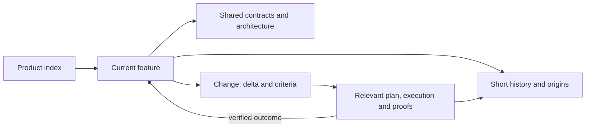

<!-- docs-nav:start -->
English · [Português (Brasil)](../pt-BR/FEATURE_DOCUMENTATION.md)

[Home](../../README.md) · [Documentation index](README.md)
<!-- docs-nav:end -->

# Where to read a feature and its changes

**A feature page explains its current definition in the declared state. A change folder explains what we intended to modify and what actually happened.** The product index connects them.

## Start with the feature

In new projects, use a features page to combine purpose, state, rules/scenarios, usage, limits and short history. Link architecture, design and proofs instead of copying them. Do not require separate manuals, definitions and current specs. Existing projects retain useful source addresses linked from the index.

| I need… | Open… |
|---|---|
| Current removal/undo behavior | features/item-removal.md |
| A new proposal for the feature | work/persist-undo/spec.md |
| That change's approach and steps | plan.md and tasks.md in the same folder when needed |
| Actual results and checks | The change's verification.md and evidence/ |
| Reasons for a rule change | Feature history → originating change/decision |
| A delivered version's contents | delivery/release-notes.md when a delivery exists |

A specification documents requirements; execution realizes/verifies them. A feature is offered behavior rather than an activity name. Research may end in a decision without implementing anything.

## Small example

```text
docs/product/
├── README.md                 features, context and changes index
├── features/
│   ├── item-addition.md       addition: rule, usage and history
│   ├── item-completion.md     completion/reopening
│   └── item-removal.md        removal/undo
├── definition/product-behavior.md  shared contracts and rule links
├── brand/DESIGN.md           common presentation
├── engineering/architecture.md   shared implementation
└── work/
    ├── add-checklist/        intent, relevant spec/plan/tasks and proofs
    └── persist-undo/         future proposal for the same removal feature
```

This tree illustrates roles. It neither initializes nor implements persist-undo. Actual pilots retain old origin IDs with descriptive reading labels. Smaller products may use sections in one page; modules are not required.

## What to save on the current page

- **Purpose and state:** audience; proposed, prototyped, implemented or available as supported by evidence.
- **Current definition:** requirements, business rules and acceptance criteria expressed as verifiable scenarios, including errors/limits that affect outcomes; preserve existing IDs.
- **Usage and relationships:** how to use it, dependencies on features/contracts and links to relevant technical design, visual design and proofs.
- **Short history:** ISO date, effect, originating change and confirmed version/availability. Detailed rationale belongs to its originating change or decision.

These can be headings or a few paragraphs, not a mandatory form. Rules owned by separate contracts remain there and are linked. Internal proof/private data is not automatically published with external guidance.

## Business rules and acceptance criteria

**The current decision belongs on the feature page.** Readers should not reconstruct it from every historical change spec. For removal/undo, the rule is “only the last removal in the session can be undone”; a verifiable criterion is “after removing A and then B, Undo restores B and preserves its state”.

| Information | Where to keep it |
|---|---|
| Requirements, business rules and acceptance criteria that remain applicable | Feature page; link shared contracts |
| Proposed delta, change acceptance criteria and relevant regressions | The change's spec.md, linked to the consumed definition |
| Pass/fail, version, environment and test proof | That change's verification.md and evidence/ |
| Reasons for a choice | Useful summary in the definition; details at the originating decision/change |

Current criteria describe expected outcomes, not a permanent passing-test badge. At closure, incorporate new requirements/rules/scenarios into their authoritative definition; retain execution results at their origin. Do not copy another feature's criteria or mandate an ID registry.

A page may exist **before code**, with a decided definition and pending implementation, when a decision records its authority/origin. Generated text is not approval. Proposals remain explicitly proposed; distinguish decided but unimplemented behavior from available behavior. “Current” means the reference definition in its declared state, revisable through another traceable decision.

## Specify the set and implement later

Several features in the known scope can be defined before writing code. Their pages are reference specifications: purpose, rules, scenarios, limits and dependencies, with explicit state. A specification does not require the filename spec.md; do not maintain another full copy under work by default.

For example, define-room-booking consolidates room registration, booking and cancellation. That work closes against documentary criteria; the pages retain a decided definition within authorized scope and absent implementation. Later implementation is another delivery, implement-room-booking, with a recoverable documentary baseline and observed technical baseline. Its spec references booking and records scope, exclusions, dependencies and outcomes to demonstrate in software. Do not invent a rule change when the intent is to realize the existing definition.

| Moment | Feature | Work and proof |
|---|---|---|
| Specification under discussion | Proposal with relevant questions/scenarios | Documentary discussion/research, without presumed approval |
| Definition completed | Decided definition; code/availability absent | Specification criteria examined; origin/version preserved |
| Implementation selected | Same definition, reexamined against current baseline/dependencies | New technical work or continuation of authorized open scope; relevant plan/tasks and execution criteria |
| Implementation verified | State/limits updated with proofs; availability only when confirmed | Technical results at their origin; definition remains readable at the same address |

An end-to-end delivery may use one work when that scope remains open and authorized. Do not resume closed work to replace its documentary objective with implementation. Before executing months later, examine changed decisions, dependencies, budget/constraints and current code. Specifying all known features does not discover or freeze every future need.

## Identify work and navigate the contents

Folder ID and title differ. The helper rejects an existing ID; distinct names with repeated intent can coexist without semantic detection. Compare baseline, objective, criteria and state before creating another work. Use a differentiating effect/context or an existing ticket/unique suffix when needed, such as implement-room-booking-20261010-a. A date alone is not unique; changing capitalization is not a portable identity. Preserve historical IDs and explain relevant relationships in brief/index, such as implements the definition, depends on or supersedes a particular decision.

The index can be contents grouped into areas/subareas, without mandatory levels:

```text
Resources
  Room registration
Scheduling
  Reservations
    Book a room
    Cancel a reservation
```

Each leaf links its authoritative source; group titles organize reading. Booking depends on registration and cancellation consumes a booking, but these are explicit relationships on the pages rather than inferred from the contents. A feature consumed by several groups retains one source linked by consumers. The index reports state without repeating rules; dependencies may cross groups or be decided but unavailable.

## Change the same feature again

Example: undo currently lasts only for the session; we want it to survive reload.

1. Read item-removal and its storage/access contracts. Retain a recoverable baseline.
2. Open a descriptively named change such as persist-undo. Its spec describes the delta and acceptance, not the whole feature again.
3. Plan, execute and verify according to risk. Retain results/proofs in the change.
4. Update the same item-removal page and affected contracts after a demonstrated result. Add its history row and delivery note when applicable.

While proposed, guidance still describes the current limit. Clarifying open work needs no new folder; a later material delivery has its own origin/baseline. A trivial text fix can use Git history without the full package.



## Grow without a mandatory hierarchy

```text
features/
├── events/
│   ├── registration.md       registration rules, usage and history
│   └── cancellation.md       cancellation with its own content
└── communication/
    └── notifications.md      contract consumed by registration
```

Areas/modules group consultation when needed. A long page can gain subtopics and its own index; do not generate empty levels or duplicate a feature for each team. Dependencies link consumed behavior/contracts rather than folder parentage. Frontend/backend describe implementation in architecture, not the manual's navigation tree.

## References and adaptation limits

[OpenSpec](https://github.com/Fission-AI/OpenSpec/blob/main/docs/concepts.md) separates current specs from changes/deltas. [Spec Kit](https://github.com/github/spec-kit/blob/main/templates/commands/specify.md) groups feature specifications with associated plans/tasks. [BMad](https://docs.bmad-method.org/plan/break-work-into-stories-and-track-it/) retains plans, criteria and evidence by work item. We adopt current-product versus change-history separation; these paths and combining rules/usage in a page are local choices, not those projects' official layout.

For a concrete example, [OpenSpec's own cli-spec specification](https://github.com/Fission-AI/OpenSpec/blob/main/openspec/specs/cli-spec/spec.md) combines requirements and observable scenarios in one file. [Spec Kit's feature template](https://github.com/github/spec-kit/blob/main/templates/spec-template.md) also combines requirements and acceptance scenarios, but it is a template rather than evidence of an implemented feature. We reuse this content structure without importing a mandatory tree or naming scheme.

WRK in the pilots was our identification convention. It names no new entity, is not a market standard and is not required by helpers. Use descriptive names for new changes; do not rename completed proofs solely for appearance.

Assistants/owners write and review documentation; helpers do not synchronize its meaning. Valid links do not prove human comprehension. [Organization](process/ORGANIZATION.md) defines destinations, [continuity](KNOWLEDGE.md) details preservation, and [scenarios](USE_CASES.md) explain partial entry and reuse.
