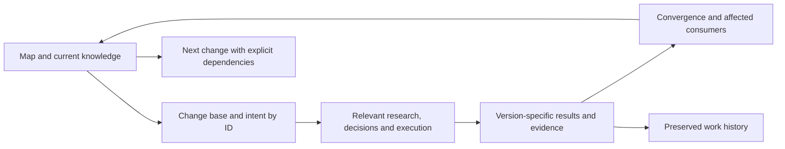
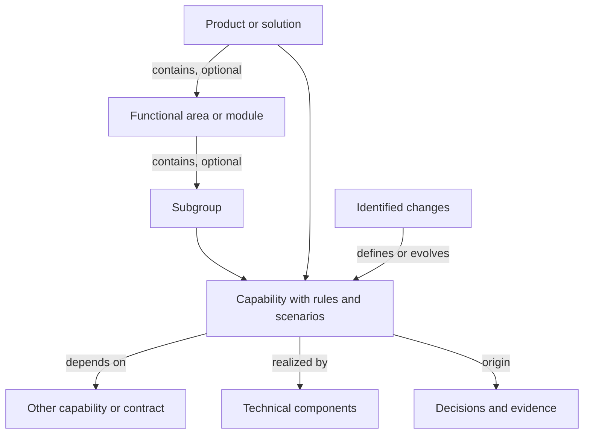

<!-- docs-nav:start -->
English · [Português (Brasil)](../pt-BR/KNOWLEDGE.md)

[Home](../../README.md) · [Documentation index](README.md)
<!-- docs-nav:end -->

# Work, current knowledge and evolution

Each work item answers a question or delivers a bounded change. It may span relevant research, decision, design, implementation and verification for one intent. Neither a folder per stage nor a code task per file is mandatory. Larger changes may consume several work results.

## Where to look

| Instance location | Question answered | Maintenance |
|---|---|---|
| docs/product/README.md | What exists today, in which state, and where is it documented? | Source/work index updated as results appear |
| docs/product/context/ | Why do we do this, and which principles/questions exist? | Current context and artifact register |
| docs/product/definition/product-behavior.md, when needed | Which current behavior guides the next change? | Rules with IDs, state, provenance, contracts and limits; may split by domain |
| experience, brand, engineering, operations, etc. | Which flows, design, architecture and operations are current? | One source per topic/rule, authored only for relevant content |
| docs/product/work/ID/ | What was requested, decided, done and verified in that change? | That version's base, differences, decisions, tasks, evidence and handoff |
| .kit/ | How does the method work, and which models are available? | Instructions/generic library, not product documentation |
| .agents/skills/ | Which procedure guides this question? | Eleven procedures, not histories or final documents |

A change spec describes intent/difference from its base; current knowledge guides today's product. Completed work should not be rewritten for every future version. When a rule has one authoritative source, the map may point to it; consolidate by domain when multiple changes scatter consultation. Avoid monolithic PRDs repeating all files.

## Update without losing provenance

1. Read map, affected sources and relevant questions. Identify consumed results/contracts and versions, plus work dependencies.
2. Pin base, scope, criteria and intent. Label research/proposals; they imply neither approval nor implementation.
3. Author necessary work artifacts. Record decisions/recoverable evidence; verify proportionally.
4. At convergence, identify differences/consumers. Incorporate only relevant results/decisions into current knowledge, with actual state and originating IDs.
5. Update map, register and affected docs. Preserve previous-version proof. Correct wrong links with reasons; history does not require retaining false relationships.

Technical evidence belongs to the examined version. If an evidence file changes, do not replace its hash to pretend verification is unchanged: retain an identified snapshot or perform relevant checks and record new evidence. Helpers detect change without judging semantic equivalence.

## Example: local checklist

The initial checklist delivery implemented creation, completion/reopening, removal/undo and persistence. The map points to current behavior, DESIGN, architecture, usage and that work's proof. Implementation documentation remains accessible when another work item becomes active.

A future text-editing feature would reference previous behavior/version as its base. Analysis checks identity, validation, focus and persistence; tasks/proofs reference criteria. Only after scoped implementation/verification does current knowledge describe text editing with new provenance. Earlier work retains its earlier delivery. This example does not claim editing exists.

## Capability is not work

A capability is something the solution enables; a domain groups related rules. Work defines, tests, implements or changes a part of that solution. Several changes may affect one capability over time without competing current definitions.

Start with few authoritative documents. When multiple changes scatter consultation, use features/<name>.md pages to combine rules, usage and history; link UX, design, architecture/contracts and proofs. Do not create another capability tree or require separate current specs/manuals. Cross-cutting relationships retain their authoritative documents. Domain folders need not mirror code folders.

Changes record base/differences: add, modify or remove identified requirements. Do not repeat all current knowledge. Research uses hypotheses/claims; decisions use IDs/context/alternatives/reasons; implementation points to requirements/contracts; verification records versions/results/limits. Origins remain recoverable. Indexes/summaries point to these sources.

## Dependencies, resumption and limits

Record useful dependencies in plans/specs and maps: source, required contract/result/version, reason and state. Research may unblock a decision; a feature may need an implemented contract. Do not infer dependencies from dates, numbers or folder proximity. active_work selects checkout work without removing history or ranking team priorities.

State availability required by the consuming stage and actually observed availability: proposals can guide design; integration execution needs implemented contracts or explicitly limited simulations. Missing dependencies become that action's open question/blocker, not fictional confirmation. Completed research is not implemented product behavior.

Decisions live in identified sources referenced by consumers. Supersession retains reason/base and connects the successor; current documentation points to current decisions. Avoid global logs duplicating every work decision. Trivial changes may simply update existing sources.

User, integrator or operator documentation is authored when those consumers exist. Tutorials teach, guides support tasks, references describe contracts, and explanations clarify reasons. Do not create four empty trees or automatically publish internal material. Update affected existing guides within delivery.

Documentation evolves through explicit assistant/team authorship and review. Scripts materialize models/manage records; they do not automatically create correct specifications or synchronize modules. Documentation review is part of delivery, not automatic publication or a requirement to generate every model.

References checked October 6, 2026: [Spec Kit](https://github.github.io/spec-kit/reference/core.html) for selected feature context; [OpenSpec](https://github.com/Fission-AI/OpenSpec/blob/main/docs/overview.md) for current specs versus proposed deltas; [ADRs](https://adr.github.io/) for decision rationale; [arc42](https://arc42.org/overview/) for architecture views; [Diátaxis](https://diataxis.fr/) for reader needs. Our adaptation keeps few documents and explicit updates without installing these frameworks or promising operational equivalence.

See [organization](process/ORGANIZATION.md), [cycles](process/WORK_CYCLES.md), [reference map](templates/README.md) and [reference behavior](templates/definition/product-behavior.md).

## Product, capabilities, groupings and implementation

Use “capability” or “feature” to describe what the solution enables, following domain vocabulary. These terms do not require two separate entities, registries or levels. A functional area/module is an optional grouping for consultation. A technical component is an implementation part. These are local conventions, not universal taxonomy: for services/events, use domain vocabulary and describe the offered result.

Product → optional group → capabilities organizes reading. Do not create fictional modules or a folder per requirement. Capabilities may span components and depend on other capabilities; changes may affect several of them. Connect them with links/IDs rather than duplicate definitions in each group. Regrouping retains identity/provenance and updates consumers with reasons.

In the pilot, adding, completing/reopening and removing each have a current feature page combining rules, usage and history. Persistence and interaction contracts remain shared; the feature pages link them. These actions span app/core/storage without requiring three modules. Future editing would be a new change with explicit impact on these sources/contracts; it does not exist yet.

Safe resumption needs recoverable baselines: commits/tags when available or snapshots/files with version/date. Check current implementation differences before consuming old proof. Ideas may be redefined, with decisions retaining reason, origin and what no longer applies.

## Capability history and delivery notes

Meaningful history belongs beside capability definitions, recording ISO dates, affected IDs, type/effect, recoverable revision/base, work/decision/proof and delivery version/date or unreleased. Avoid complete execution diaries. One change may affect several capabilities; link origins at relevant authoritative sources. Small products can use one table in current behavior without another log file per requirement.

Product versioning normally suffices. Capabilities record versions in which they changed and revisions defining rules; independent versions fit independently distributed packages/APIs/contracts. This requires context, not a universal rule. Dates support period lookup; releases collect changes actually available to stated audiences/environments, with relevant limits/migrations. Completed research or marked tasks are not launches.

Author [delivery notes](templates/delivery/release-notes.md) when needed. Conceptual references are [Keep a Changelog](https://keepachangelog.com/en/1.1.0/) and [Towncrier](https://towncrier.readthedocs.io/en/stable/tutorial.html) change consolidation. No copied models or installed executors. Existing work IDs provide origin without extra mandatory fragments/changelogs per request. Authorship and period filtering remain assisted/manual.

## Proportionate grouping and growth

An area/module may contain subgroups and collect capabilities when the domain requires it. Start with headings and links in the map; do not mandate fixed levels, a folder per node or duplicated definitions across groups. Split a source when consultation, ownership or risk requires it, preserving IDs and authority. Rules/scenarios may stay together. A small solution may need only a map and behavior; a complex one may have domain indexes pointing to responsible definitions.

Separate three relations: **contains** organizes navigation; **depends on** identifies a result/contract, version and availability; **is realized by** connects behavior to implementation. A tree does not replace cross-cutting dependencies. Technical components may have their own architecture decomposition without forcing functional modules to coincide with services/packages. Regrouping records reasons and updates links/consumers while preserving identity and provenance.

The selective recursive decomposition in [arc42](https://docs.arc42.org/section-5/) is an architecture reference; [C4 abstractions](https://c4model.com/abstractions) describe technical structure. [OpenSpec](https://github.com/Fission-AI/OpenSpec/blob/main/docs/concepts.md) admits logical spec groupings. Our separation of functional navigation, dependencies and implementation is a kit choice, not adoption of a universal hierarchy. Checked on 2026-10-06.

Physical addresses group subjects; reading begins with map questions. Brand uses positioning/voice, behavior uses rules/scenarios and architecture uses responsibilities/contracts. Their forms differ. See the [usage guide](GUIDE.md) to locate reading and writing destinations.

## Preservation at closure

While work is active, evidence changes invalidate closure until examined/re-recorded. At completion the helper captures exact bytes of evidence sources outside the work folder (current definitions, code etc.) under evidence/baselines, retaining hash and original_path. Later current-knowledge evolution therefore does not invalidate that examined version. A snapshot is identified historical material, not current navigation or evidence of future-version testing.

For legacy completed work, use `-Action preserve-evidence -Id change-id` **before** changing sources still referenced by proof. The helper requires matching old hashes; it cannot recover lost bytes, rewrite digests to pretend verification or reopen criteria/closure. Within-work evidence stays at its preserved destination. This protects current criterion/convergence proof, not every previous round's versions. It is a local choice without multiuser transactions; snapshots cost storage and do not replace Git/backups.

## Feature consultation

The [focused guide](FEATURE_DOCUMENTATION.md) distinguishes current specs, change deltas, execution and manuals. A feature normally retains its consultation address across deliveries; later material changes have their own work/baseline. Justified reorganization may move the authority while preserving identity/provenance, updating the map/consumers and retaining an old pointer where useful, as described in [organization](process/ORGANIZATION.md). Use pages/sections when sufficient and area chapters when navigation warrants them. New changes use descriptive names; historical IDs do not identify features.
