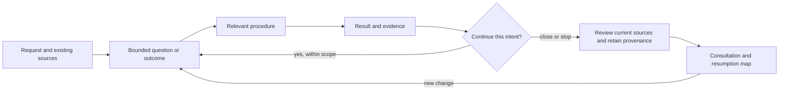

<!-- docs-nav:start -->
English · [Português (Brasil)](../pt-BR/USE_CASES.md)

[Home](../../README.md) · [Documentation index](README.md)
<!-- docs-nav:end -->

# Use and reuse scenarios

This guide helps choose an entry and find its results. Scenarios are hypothetical examples and inspection routes, not interviews, executed experiments or certification of every stage. [Guide](GUIDE.md), [workflows](process/WORKFLOWS.md) and [feature consultation](FEATURE_DOCUMENTATION.md) retain their responsibilities; this page is not another executor.

## A complete journey without filling every directory

Hypothetical example: a team needs to organize workshop registrations. Its initial bet is that manual confirmation loses information. Before building software, choose what to investigate and which small outcome will support a decision.

| Transition | Useful result and consultation source | Condition for the next action |
|---|---|---|
| Idea and research | Context, question, sources and counterevidence; context/idea and responsible research | Enough signals to bound a bet; demand remains a hypothesis without appropriate observations |
| Problem, feasibility and MVP | Candidate audience, current alternative, experiment and constraints; definition/business | Choose the smallest test of uncertainty. A manual process may suffice; software is not assumed necessary |
| Experience | Register, confirm, cancel, failures/access; flows/prototype | Reviewable representation and relevant criteria; do not claim unperformed user testing |
| Brand/visual | Proportional voice or visual contract when relevant | A complete identity is not required to test a form's comprehension |
| Engineering | Compare local options, data, access, cost and maintenance; technical sources | If code is needed/authorized, establish base, criteria and treatable risks. A technical proof can precede visual detail |
| Small delivery | Bounded change, necessary spec/plan/tasks and actual verification | Correct gaps and consolidate current rules/guides; availability requires a confirmed environment |
| Pilot/operations | Plan and, when executed, episodes/results and limits | Decide to continue, revise or stop; planning does not authorize publication/contact |
| Evolution | New question/change linked to its base and affected sources | Reuse current knowledge while retaining earlier provenance |

One work item can span relevant stages of its intent. Distinct bets/deliveries can have linked work items. A roadmap prioritizes outcomes; it is not the list of templates to generate. If investigation rejects a hypothesis, record the conclusion/reason, review consumers and close without fictional architecture.

## Use each procedure independently and return to it

Hypothetical readers: novice founder, researcher, designer, engineer, operator and maintainer. Reuse describes what changes upon return, not another stage. Named documents are destinations/IDs from the [catalog](process/CATALOG.md), authored only when relevant. Full procedures are linked in [SKILLS](process/SKILLS.md).

| Procedure | First entry | Reuse / challenge | Consultable result |
|---|---|---|---|
| guide-product | “I have this idea; what question comes next?” | Resume after a pause, enter an existing product or change scope; read base/request before selecting a stage | Relevant map, idea, principles, open-questions, artifact-register and handoff |
| research-product | “Do existing alternatives solve this problem?” | A new source contradicts a premise: check origin/date, update conclusion/consumers without repeating all research | Reusable desk-research or change research; evidence-review as needed |
| assess-feasibility | “Which experiment fits our capacity?” | Cost/time ceiling changes: compare scope/manual/defer options and revise the bet; do not invent a budget | problem-and-value, experiments-and-mvp, feasibility, capacity-costs-and-evolution |
| design-experience | “How does someone complete this task?” | Review cancellation, lost access or errors against existing rules; avoid redesigning everything | flows-and-prototype, design-and-accessibility-review; scenarios/criteria in relevant spec |
| define-brand-design | “Which direction and language serve this proposal?” | Correct component contrast/state while retaining positioning; examine consumers/rendered material | brand and DESIGN; written direction does not prove visual quality |
| plan-engineering | “How can we meet these requirements locally?” | Assess existing code, integration or an observed technical limit; challenge alternatives and user choice | existing-project-assessment, constraints-and-quality, architecture, technologies, decisions-and-technical-review, diagrams, structure-and-development, dependencies-and-infrastructure |
| review-security | “Who can access/publish this data?” | Review a new boundary, contract or dependency; distinguish proposed threat, confirmed flaw and tested control | security-and-privacy, corrective requirement/task and responsible verification |
| deliver-slice | “Implement this small local delivery” | Fix reproducible failure or change the same feature: read current knowledge, pin base and verify relevant regression | Relevant work spec, plan, tasks, consistency, verification, convergence; updated map/guides |
| evolve-product | “How do we run and observe a pilot?” | Actual reports/incidents/results become sourced research, fixes or improvements; release requires confirmed availability | Relevant launch-and-operations, roadmap-and-management, decisions-and-changes and release-notes |
| challenge-assumptions | “Challenge this decision before investment” | Reassess architecture/UX/demand when evidence changes; critique does not silently implement a different solution | critical-review or work decision with reasons/evidence and consumers |
| maintain-knowledge | “Where is the current rule? Documents disagree” | Consolidate another delivery of the same feature, move a chapter or repair a link; retain earlier proof | Corrected source, map/history and convergence; no full manual per change |

There is no requirement to invoke all of them. Contrast review can use experience, DESIGN and verification; research can end without code; engineering can start in an existing product without redoing brand or personas. Line count does not determine fix depth: impact, uncertainty and verifiability guide the record.

## Cross-cutting resources: scenarios that reveal failures

| Situation | Use/reuse and expected result | Limit to check |
|---|---|---|
| New instance or existing documentation | Lean initialization in a new destination; map/link existing sources before adapting legacy organization | The initializer is not a repository migrator; do not overwrite or duplicate manuals |
| A file does not exist yet | Consult catalog; materialize only the document answering the question, replacing template status with an actual result | materialize preserves existing files; it does not research, translate or finish a stage |
| Different language/AI client | Stable technical names; narrative follows output_language; read skills if the client does not discover them | Do not rename work or assume automatic translation/discovery; public docs have EN/PT pairs |
| Continuous mode and interruption | Define scope/criteria/limits; record rounds/transitions, pause/reason/next step; resume upon request | No daemon or continuation after session end; missing essential answers block only dependent actions |
| A completed work item is selected | Read its result as history; another material delivery gets its own ID/base and the same feature page | active_work is not outstanding work or priority; do not reexecute completed work |
| No progress, rejected hypothesis or cancellation | Record cause/conclusion, retain useful findings and stop/revise strategy; correct affected consumers | Do not weaken criteria or repeat prose to simulate progress |
| A source or rule changed | Recheck claims/consumers; retain relevant version. complete captures proof outside work; intact legacy work uses preserve-evidence before edits | Hashes establish bytes, not truth. Disposable scratch may be discarded; decisive sources/evidence must not live only in ignored scratch |
| Same feature, another delivery | Current rule/guide → new delta → verification → update same source/page linked to the new work | Historical spec is not the manual for all versions; tutorials/contracts need not repeat content |
| Frontend/backend or several repositories | Reference responsible contract, consumed version/revision and availability; establish consumer updates | A valid local link does not guarantee access elsewhere. Another copy does not solve synchronization without a rule |
| Two simultaneous maintainers | Use IDs/checkouts/branches and review consolidation of shared knowledge | One active_work per checkout; helpers do not coordinate concurrent writes. No transactional multiuser claim |
| Product release and kit distribution | Distinguish implemented/available, consolidate relevant notes; generic package retains license/credits | Completed work does not publish a product. Private instance data does not accompany public distribution |

Commands/contracts remain in [cycles](process/WORK_CYCLES.md), [organization](process/ORGANIZATION.md), [language](LANGUAGE.md) and [credits](CREDITS.md). Materialization IDs come from the catalog; execution stages come from the helper contract. Do not assume every grouping name accepts the same parameter.

## What was demonstrated and how to explore further scenarios

In the list pilot, initial delivery and a later documentary improvement link to the same Remove/undo feature. The documentary workshop demonstrates revising a proposal without claiming implementation. These are examined consultation/continuity examples, not demonstrations of the whole table or human validation.

To explore another scenario, choose question/person/base, follow entry → current source → procedure → output → consumers, and record obstacles in the relevant work/review. Execute tools only when they verify the requested result. Do not create an instance, report or automated test for each table row.

Future unassisted reader test: find a current rule, distinguish proposal from availability, discover why it changed and prepare an alteration without rewriting old proof. Record observed attempts/difficulties; correct demonstrated gaps. Author inspection does not replace this test.
