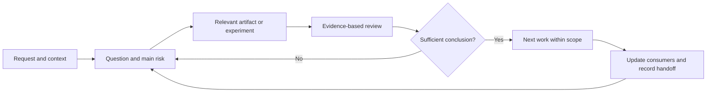

<!-- docs-nav:start -->
English · [Português (Brasil)](../../pt-BR/process/STAGE_CONTRACTS.md)

[Home](../../../README.md) · [Documentation index](../README.md)
<!-- docs-nav:end -->

Reading reference; operational source: `templates/.kit/STAGE_CONTRACTS.md`. This page is not an installed skill or an authored project deliverable.

# Local workflow transitions and resumption

Process 0.1.0. There is no automatic execution, mandatory approval or requirement to complete every model. Choose a question, reuse existing work and record the result. Procedures are independent and include their own contracts.

| Work | Input needed now | Output sufficient to advance | Do not anticipate without reason |
|---|---|---|---|
| Discover | Candidate situation/problem, intent, sources and decisive constraint | Investigable question, hypothesis and unknowns | Stack, complete screens, full schedule |
| Research | Decision-changing question and existing evidence | Synthesis with source/limits/counterevidence and recommendation | Fictional interviews, unlimited research |
| Define bet | Signals, current alternative and relevant capacity | Outcome, candidate audience, non-goals, risk and experiment | Presumed validated market or revenue |
| Prototype | Relevant journey/rules and usage uncertainty | Reviewable representation, states, protocol and findings if performed | Final brand for a simple interaction test |
| Choose brand/visuals | Usage/audience and existing identity | Proportional visual contract and inspected examples | Every screen/token before selecting direction |
| Plan engineering | Behavior/quality, capacity and technical risk | Alternatives, decision/questions, contracts and proof when needed | Cache, microservices or public provider by habit |
| Implement slice | Requested scope, baseline and observable criteria | Verified behavior, limits and updated knowledge | Automatic publication or purchases |
| Pilot/operations | Demonstrable delivery, audience, access and support | Results, failures, costs and bet decision | Fabricated metrics or checklist approval |
| Evolve | Sourced report/metric/incident/change | Impact, updated current knowledge and relevant verification | Repeating entire discovery |

Ask about missing information only when it changes the next action; record other gaps with review conditions. Unknown hosting budget should not block a wireframe. Anticipate privacy, offline requirements or investment limits if they invalidate the bet. Do not defer authorization/access until after affected flows are designed.

At closure, record actual results, state (proposed/observed/decided), authoritative files, open questions and next action/condition. Update current_phase in .kit/project.json only to reflect general context; identified work stage is state.json.execution.current_stage. Neither field proves approval. Resumption reads that record and the current request instead of reexecuting every stage.

Reviews may return to their source. If a rule changes, identify consumers in the responsible source/map or, when needed, docs/product/context/artifact-register.md; correct current knowledge and identify history. Technical proof may precede visual details; prototype testing may return work to problem definition.

Details: [progressive gathering](STAGE_INFORMATION.md), [MVP/experiments](../templates/definition/experiments-and-mvp.md), [design review](../templates/experience/design-and-accessibility-review.md) and [slice contract](WORK_CONTRACT.md).

Apply [organization](ORGANIZATION.md), [catalog](CATALOG.md) and [cycles](WORK_CYCLES.md): relevant materialization, explicit active work, preconditions, consistency, contextual TDD and final comparison. File presence does not demonstrate sufficient content. Scripts need PowerShell 7.2+.
