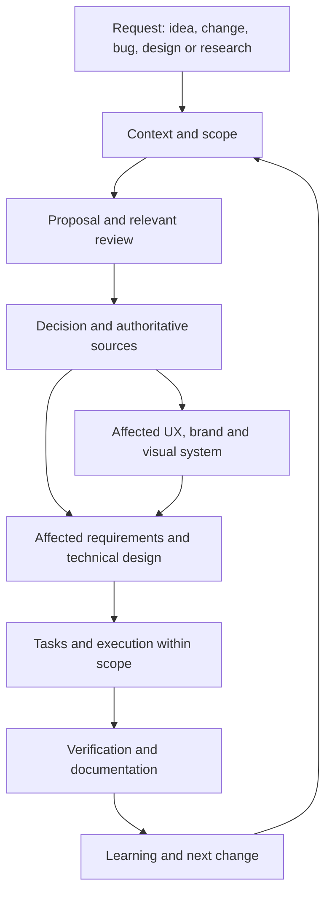

<!-- docs-nav:start -->
English · [Português (Brasil)](../../pt-BR/process/WORKFLOWS.md)

[Home](../../../README.md) · [Documentation index](../README.md)
<!-- docs-nav:end -->

Reading reference; operational source: `templates/.kit/WORKFLOWS.md`. This page is not an installed skill or an authored project deliverable.

# Entry points and stage integration

Use [stage contracts](STAGE_CONTRACTS.md) to identify what to consume, deliver, defer and save for resumption. Order follows uncertainty and scope, not folder numbers.

Process version 0.1.0, independent local workflow. Entry depends on the current request, work_type and product state. Starting from an idea is optional. Select procedures from the [skills map](SKILLS.md); personal tools/specialists are not prerequisites.

| Entry | First work | Relevant stages | Result |
|---|---|---|---|
| New idea/product | Context, problem and main unknown | Research → critique → product/business → UX/design → engineering/delivery as relevant to the bet | Justified next bet, not full approval |
| New feature | Read existing product/code/specs and versioned base; understand requested outcome | Proposal/impact → research/critique for uncertainty → affected spec/UX/design/architecture → tasks/verification | Bounded change with updated consumers |
| Fix | Expected versus observed, reproduction and impact | Diagnosis → cause/evidence → bounded correction → regression/verification | Original symptom checked and cause treated; no default broad redesign |
| Design/UX/brand | Experience problem and existing material | Flows/rules → alternatives → visual review → tokens/copy/implementation if authorized | Visual/experience decision with appropriate evidence |
| Architecture/refactor | Demonstrated quality requirement/limit | Alternatives/technical proof → technical decision → contracts/data → tasks/verification | Proportional technical change and review conditions |
| Research | Decision-blocking question | Sources/protocol → synthesis/counterevidence → recommendation | Bounded answer or next experiment |

A feature can be discussed as a proposal change before any code exists. Record “planned” instead of assuming implemented behavior.

## Define multiple features and implement later

All features in the known scope may be specified without starting code. Begin with the map and author responsible sources under features, or existing documentation linked by the map: purpose, rules, scenarios, limits and dependencies. Record proposals, decisions with origin/authority and gaps; do not treat the set as permanently complete. One bounded documentary intent may cover several features; a work per page is unnecessary.

Two paths are legitimate. An authorized end-to-end delivery can keep one work across definition, engineering and implementation, with criteria for that scope. If the request ends at specification, close work against documentary criteria and retain features as defined but unimplemented. Later implementation opens another work linked to the definition; do not resume closed work or reuse documentary criteria as software proof.

Example: define-room-booking completes booking rules/scenarios in features/reservations/booking.md; implement-room-booking realizes them later. The new spec may reference the definition rather than copying it or inventing a rule change: the delta is now between defined behavior and absent/partial technical state. Identify a recoverable documentary baseline and observed technical baseline, actually available dependencies, scope, execution criteria and regressions. Plan/tasks appear as the selected implementation needs them. Implementing other features repeats this selection, not all discovery.

On resumption, check whether the definition/dependencies changed since planning. A documentary decision alone authorizes neither development nor publication; time between stages may require revisiting assumptions or plans. Closing definition does not change availability in the index.

Information gathering is progressive: follow [stage information](STAGE_INFORMATION.md), reusing previous results and asking only about relevant gaps. Planning, prototypes, implementation and checks can occur locally following [structure and development](../templates/engineering/structure-and-development.md), without mandatory publication or remote CI. Authorized scope and appropriate criteria are still required.

## New feature workflow

1. Contextualize the outcome and identify requirements/behavior/code baseline.
2. Record proposal, non-goals, audience, benefit/hypothesis and expected effects.
3. Map relevant effects on UX, brand/tokens, data/APIs, access, compatibility/migration, tests, docs and operations.
4. Challenge assumptions and a simpler alternative; resolve material unknowns.
5. Update/create the change spec; author plan/tasks when technical execution is authorized.
6. Verify the change/relevant effects, update current docs and record result/review.

Create docs/product/work/ID for significant delivery/change, linked to source/base. The method contract lives in .kit/WORK_CONTRACT.md without another canonical backlog; small changes may use short records. Do not copy the entire project per request.

## Correcting an earlier stage

When research was overstated, review failed or a rule is ambiguous, return to the authoritative artifact, record the reason and consumers needing review. Do not regenerate the whole chain or retain a false conclusion to protect the first version.

Use assumption review for bets/uncertainty and the local slice contract for spec/plan/task consistency and corrections. Documentary consistency is not observed benefit.

## How stages connect

| Origin | Consumed input | Authoritative output | Next consumer |
|---|---|---|---|
| Context | Intent, history, limitations | docs/product/context/idea.md and source register | Research/product/critique |
| Research | Question, audience, alternatives | docs/product/research/desk-research.md | Product, business and review |
| Review | Proposal/evidence/alternatives | docs/product/reviews/critical-review.md | Decision and affected artifacts |
| Product/business | Sources, critique and capacity | Feature definitions under docs/product/features or existing source linked by the map; shared context/contracts under definition and feasibility under business | Roadmap, UX, brand, engineering and QA |
| UX/brand/design | Outcome, audience and rule | docs/product/experience and docs/product/brand | Spec and interface implementation |
| Engineering | Requirements, constraints/UX | Decisions in docs/product/engineering; slice plan/contracts | Tasks and verification |
| Delivery | Bet, decisions and plans | docs/product/delivery/roadmap-and-management.md + handoff/change artifacts | Execution/acceptance |
| Quality | Scenarios/contracts/versions | docs/product/quality/verification.md or referenced slice result | Release and decision |
| Operations | Delivery, limits and audience | docs/product/operations | Research/changes |
| Evolution | Results, decisions, reports | docs/product/evolution + updated authoritative sources | Relevant new entry |

Integration currently relies on reading, references, IDs/versions and explicit assistant updates. No engine synchronizes files or automatically executes every responsibility.

Cross-cutting review: check relevant open questions, evidence and consumers on delivery entry/resumption and closure. Security, dependencies/infrastructure and diagrams are engineering/review inputs and outputs according to impact, not separate phases after all code.

Technical decisions follow [recommendation, challenge and final choice](../templates/engineering/decisions-and-technical-review.md), based on product and capacity. Separate recommendation from user decision; update architecture, stack, frontend/backend organization, contracts and CI/CD according to impact.

## Design responsibilities

Research identifies the job; UX models interaction; brand defines promise/voice; visual system defines tokens/components; engineering applies contracts; review checks results. These can be modes of one assistant. Available skills may support the responsibility; do not require multiple agents or entire collections.

Apply [organization](ORGANIZATION.md), [catalog](CATALOG.md) and [cycles](WORK_CYCLES.md): relevant materialization, explicit active work, preconditions, consistency, contextual TDD and final comparison. File presence does not demonstrate sufficient content. Scripts need PowerShell 7.2+.
