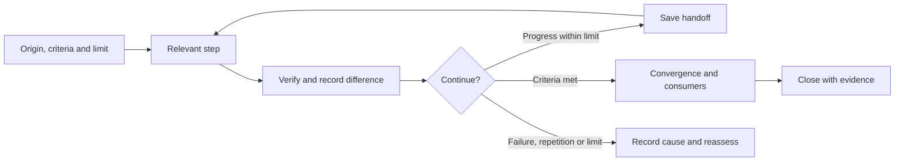

<!-- docs-nav:start -->
English · [Português (Brasil)](../../pt-BR/process/WORK_CYCLES.md)

[Home](../../../README.md) · [Documentation index](../README.md)
<!-- docs-nav:end -->

Reading reference; operational source: `templates/.kit/WORK_CYCLES.md`. This page is not an installed skill or an authored project deliverable.

# Cycles, verification and stop conditions

Process 0.1.0: bounded objective → relevant step → evidence → continue/close decision. The same assistant guides by default. No new-session executor, scheduling, external service or automatic scope expansion.

## Guided or continuous

execution_mode in .kit/project.json accepts guided (default) or continuous. Work declares stop_after=stage or delivery and allowed_stages. guided delivers the current result and recommends a transition; continuous permits continuing through relevant already-authorized results without routine stage confirmations. Neither requires every folder.

Continuity still includes questions: use existing data, declare reversible hypotheses and ask when an answer changes a material decision. If essential, save the next step and pause dependent work; continue only independent work. Do not pretend interviews, approval, purchases or publication. A local MVP authorization does not authorize production deployment.

advance-stage records stage, reason and evidence; pause records a reason and preserves results. resume requires an explicit reason and limit. Helpers do not execute stages: the assistant works in the session and persists memory. After the session ends, the host needs a resumption request; there is no daemon, scheduler or portable auto-resume.

```powershell
& ./.kit/scripts/work.ps1 -Project . -Action start -Id clarify-registration -Title 'Bounded delivery' -Origin 'Request' -Base 'Current version' -Objective 'Verifiable result' -Criteria 'Observable criterion' -StopAfter delivery -Stage research -AllowedStages research,product,experience,engineering,quality,delivery -MaxRounds 8
& ./.kit/scripts/work.ps1 -Project . -Action pause -Reason 'Waiting for essential information'
& ./.kit/scripts/work.ps1 -Project . -Action resume -Reason 'Information received' -MaxRounds 8
```

Continuous guidance depends on the assistant and host tools. Files preserve state for requested resumption; helpers are not an execution engine.

## Preparation and resumption

Before starting, define source/base, intent, non-goals and observable criteria. Read decided principles and authoritative sources. Resolve behavior-changing ambiguities before deriving a plan; compare spec/plan/tasks before implementation. Irrelevant information remains unknown without blocking independent work.

```powershell
& ./.kit/scripts/work.ps1 -Project . -Action start -Id clarify-registration -Title 'Bounded question' -Type research -Origin 'Identified request and source' -Base 'Source version/date' -Objective 'Verifiable result' -Criteria 'Observable criterion' -MaxRounds 3
& ./.kit/scripts/work.ps1 -Project . -Action select -Id clarify-registration
& ./.kit/scripts/work.ps1 -Project . -Action check -Phase execute
```

Default ceiling is three recorded rounds, adjustable by work. It is not a token/cost budget or total duration. Record usage when available and respect session limits; do not invent measurements. The helper manages records/state without starting the assistant. Stop execution for cancellation, actual blockage, material failure or limits. Other authorized independent work may continue.

## Execute, check and record

Choose a step that can change the answer or meet a criterion. Record actual result, procedure/command, expected/observed, files/sources and next step. Repeated text is not progress. Persist findings and useful attempts in the authoritative artifact before resuming.

```powershell
& ./.kit/scripts/work.ps1 -Project . -Action record-round -Result progress -Summary 'Observed result and limits' -Evidence 'docs/product/work/clarify-registration/research.md' -MetCriteria C001 -NextStep 'Compare delivery with intent'
```

Evidence must be actual files within the project: reports may reference external sources/commands. Library, state and handoff do not prove delivery. Helpers check existence/hash; truthful, sufficient content needs relevant inspection/execution. Met criteria are traceable owner declarations, not automatic certification.

plan/execute checks require intent, criteria and existing/authored declared sources; separate spec, plan and tasks files are optional. An unfilled materialized template blocks the check when it belongs to the work. This does not certify semantic readiness: clarify rules, dependencies and authorization even when the necessary information fits one record.

For collaboration, pass -Id on actions; active selection is shared. Helpers compare the read hash and write under a short local lock, exercised across processes in the same Windows session. A stale read receives a conflict and must reload/reconcile before retrying. Protection does not integrate document edits, coordinate other sessions/machines/writers or replace review/Git and isolated checkouts.

Round result: progress, no_progress, blocked or failed. Repeated evidence without a new criterion stops as no_progress. Repeated failure calls for strategy/scope review. resume requires explicit Reason and MaxRounds without clearing rounds. cancel records Reason in closure. Material new scope receives separate work linked to the previous base.

## Methods within the cycle

SDD aligns intent, plan and tasks. BDD-inspired scenarios make criteria concrete. Use TDD for significant deterministic rule/contract/fix verification: write a test, observe failure for the expected cause, implement what is needed, observe pass and refactor preserving behavior. Record Red and Green evidence; planning tests or writing them afterward does not prove TDD.

TDD is not mandatory for research, simple documents or disposable visual exploration. Existing code follows conventions, strategy and risk; justify alternatives when TDD is unsuitable while retaining necessary checks. Accessibility/UI needs relevant inspection beyond automated tests. Avoid tests that merely repeat implementation. TDD does not validate demand.

Agile principles support small deliveries, feedback, value/risk priority, limited capacity and direction review. Roadmaps organize bets, not obligations to execute everything. Do not impose Scrum ceremonies, fictitious teams or estimates without data.

## Consistency and convergence

Before implementation, record conflicts among requirements, plan, tasks and criteria: uncovered requirement, task without source, infeasible dependency, untreated risk. Correct the authoritative document before deriving a contradictory one. Reviews may return work to its source.

After implementation/delivery, compare intent with results, including missing, partial, conflicting requirements and additions without requirements. Findings identify source, evidence, impact and correction/decision. Create corrective tasks with IDs/relationships without renumbering old tasks or silently weakening criteria. Do not repeat passed tests without changes/new risk. Documentary review does not replace testing or research with people.

```powershell
& ./.kit/scripts/work.ps1 -Project . -Action record-convergence -Result clear -Summary 'Criteria and consumers checked within scope' -Evidence 'docs/product/work/clarify-registration/convergence.md'
& ./.kit/scripts/work.ps1 -Project . -Action check -Phase complete
& ./.kit/scripts/work.ps1 -Project . -Action complete
```

Completion requires criteria with current evidence and recorded convergence without gaps. Changed evidence requires renewed review/recording. No checkbox authorizes publication, validates a market or removes unevaluated risks. Preserve results, limits, open questions and updated knowledge; handoff is a derived summary.



## Preservation at closure

While work is active, evidence changes invalidate closure until examined/re-recorded. At completion the helper captures exact bytes of evidence sources outside the work folder (current definitions, code etc.) under evidence/baselines, retaining hash and original_path. Later current-knowledge evolution therefore does not invalidate that examined version. A snapshot is identified historical material, not current navigation or evidence of future-version testing.

For legacy completed work, use `-Action preserve-evidence -Id change-id` **before** changing sources still referenced by proof. The helper requires matching old hashes; it cannot recover lost bytes, rewrite digests to pretend verification or reopen criteria/closure. Within-work evidence stays at its preserved destination. This protects current criterion/convergence proof, not every previous round's versions. It is a local choice without multiuser transactions; snapshots cost storage and do not replace Git/backups.
