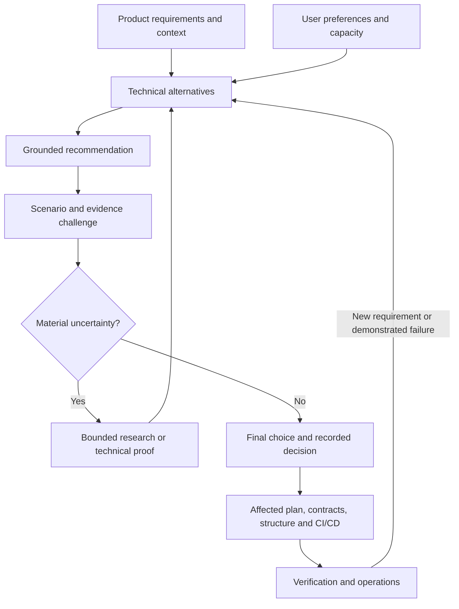

<!-- docs-nav:start -->
English · [Português (Brasil)](../../../pt-BR/templates/engineering/decisions-and-technical-review.md)

[Home](../../../../README.md) · [Documentation index](../../README.md)
<!-- docs-nav:end -->

Reading reference; operational source: `templates/docs/product/engineering/decisions-and-technical-review.md`. This page is not an installed skill or an authored project deliverable.

# Technical recommendation, challenge and decision

Status: protocol/model; no technology or architecture approved by this file.

## Purpose and inputs

Translate the idea/current scope into justified technical alternatives, review consequences and record user decisions. Applies to architecture, technologies, frontend/backend organization, contracts, data, integrations and CI/CD. Users may choose differently from the recommendation; reasons/limits remain visible.

Read versioned requirements/rules, flows, data/audiences, constraints, capacity and current decisions. Classify inputs as requirements, preferences, hypotheses or unknowns. Draft technology suggestions are not obligations. Treat user-defined technology as an explicit constraint and assess feasibility; do not reopen the whole stack without material reason.

Architecture and stack decisions are related/iterative: requirements guide responsibilities/alternatives; technology limits may require design revision. Comparing a library does not require freezing the entire architecture.

Connect recommendations to [investment, maintenance and evolution limits](capacity-costs-and-evolution.md). For existing systems, start with [evidence-based assessment](existing-project-assessment.md), without default rewrites or new infrastructure.

## Recommend and challenge

Turn priority qualities into scenarios: trigger/actor, condition, system response and verifying evidence. Numeric targets require recorded requirements/assumptions rather than invented numbers.

Compare viable options, including the simplest or keeping the current solution. Consult current official sources; record version/date/context. Explain total cost, team familiarity, maintenance, security, compatibility, portability and limits. Scores need justified criteria/weights; popularity is insufficient.

Review the strongest proposal rationale. The same assistant can explicitly take a second pass; do not claim external independence or automatically create agents. Challenge both user-preferred options and assistant recommendations.

| Affected area | Challenge question | Relevant evidence/output |
|---|---|---|
| Architecture | Are scenarios, coupling, consistency, failures/recovery coherent? Can the team manage complexity? | Relevant diagrams/contracts, simple alternative, risks and ADR |
| Frontend | Do navigation, loading/error states, access, accessibility, rendering and state/data meet the flow? | Flows/components and decision-appropriate proof/render/tests |
| Backend/data | Who validates rules/access? Are integrity, contract/data evolution, migration/recovery covered? | Models/contracts and verification scenarios |
| Code organization | Are boundaries/dependencies understandable? Does a monorepo or separate repositories help actual delivery? | Responsibility-linked structure, execution guide and rationale |
| Integrations | Are timeout, retry, idempotency, compatibility, credentials and partial failures treated proportionally? | Contract, sequence/failure views and verification |
| CI/CD | Do checks cover change risk? Are artifacts/versions traceable? Are secrets/permissions, environments, migrations, deployment/recovery coherent? | Pipeline proposal/criteria; logs only for actual execution |
| Operations | Do cost, observability, backup/restore, support and dependencies fit capacity? | Testable assumptions, known owners and operations plan |

Select relevant areas only. Documentation supports proposals without proving performance, isolation, recovery or working pipelines. Use bounded technical proof when material unknowns cannot be resolved from sources.

## Final user choice

Present recommendations, alternatives and consequences accessibly. For open decisions, offer a concrete reviewable choice. If sufficient authorization/preference exists, proceed within it without repeating questions.

Separate assistant recommendation from user decision. Adapt the plan for another viable user choice, recording reasons/residual risks. For demonstrated conflicts with essential requirements, show incompatibility and propose requirement change, mitigation, experiment or alternative. Preference alone does not resolve conflict; do not mark requirements met or silently replace choices.

## Significant decision record

Use an ADR here or in the authoritative plan, without competing copies:

- ID/date, question, scope and state: proposed, decided, experimental or superseded.
- Used requirements/scenarios, sources/versions, preferences and unknowns.
- Alternatives/comparison and justified assistant recommendation.
- Challenge: failure trigger, consequence, supporting/opposing evidence, mitigation and needed proof.
- User choice/reasons; without a recorded choice, status remains proposed.
- Consequences/risks, verification criteria and revisit conditions.
- Affected consumers: architecture, technologies, UX, security, contracts, structure, plans/tasks, CI/CD and operations by scope.

Revisit changed requirements, capacity, costs, support or failure evidence. Small changes may use short records. Do not recreate discovery or unaffected decisions.

## Process connection

Use [challenge-assumptions](../../../../templates/.agents/skills/challenge-assumptions/SKILL.md) and [critical review](../reviews/critical-review.md), referencing the technical decision. Relate questions/evidence to authoritative files. Handoff supplies decisions/criteria to the technical plan; the local slice contract consumes references and retains authoritative spec/plan/task sources. Consistency analysis does not replace architecture review or CI/CD execution.

## References and limits

Consulted October 5, 2026. Original local procedure inspired by [ATAM/SEI](https://www.sei.cmu.edu/library/architecture-tradeoff-analysis-method-collection/) for scenarios/risks/quality tradeoffs, [arc42](https://arc42.org/overview/) for proportional documentation, and [architecture-designer](https://github.com/Jeffallan/claude-skills/blob/main/skills/architecture-designer/SKILL.md) for requirements, alternatives, ADRs and review. The upstream skill is community-authored, not official Anthropic; practices inform this procedure without importing its package or stack examples.

[Microsoft Well-Architected](https://learn.microsoft.com/en-us/azure/well-architected/) pillars help frame reliability, security, cost, operations and performance questions. Use relevant concepts without adopting Azure or treating vendor checklists as universal requirements. This is neither formal ATAM assessment nor certification.
