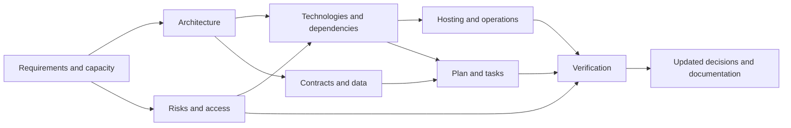
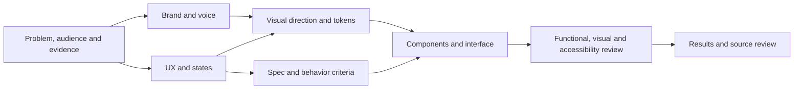

<!-- docs-nav:start -->
English · [Português (Brasil)](../../../pt-BR/templates/engineering/diagrams.md)

[Home](../../../../README.md) · [Documentation index](../../README.md)
<!-- docs-nav:end -->

Reading reference; operational source: `templates/docs/product/engineering/diagrams.md`. This page is not an installed skill or an authored project deliverable.

# Diagrams that answer questions

Status: guide; examples show the process, not implemented product architecture.

| Question | Suitable representation | Document/consumer |
|---|---|---|
| Who uses the system and where does it connect externally? | Context, C4 when useful | Requirements/architecture |
| Which components store/process information? | Containers/components and flow | Architecture/plan |
| How does an action cross parts and fail? | Sequence with relevant failure/retry | Contracts/tests |
| What data, relationships and constraints exist? | Conceptual/ER model | Data/migrations |
| How do people navigate/understand states? | Journey, flow/states or wireframe | UX/design/spec |
| Which boundaries/data need protection? | Data flow with trust boundaries | Security/review |
| How is it released/recovered? | Deployment/environments and recovery | Infrastructure/operations |
| How do tokens/components reach the product? | Design system/handoff map | Design/engineering/quality |

Each diagram states question, base/version, legend and assumptions; use actual domain names when authoring. Retain relevant IDs/links. Do not require every view; Mermaid aids Markdown review without replacing wireframe/UI inspection when that is the question.

## Technical choice connections

## Design system connections

Diagrams without questions or merely repeating text can be omitted. Outdated diagrams need review alongside their decision consumers.
