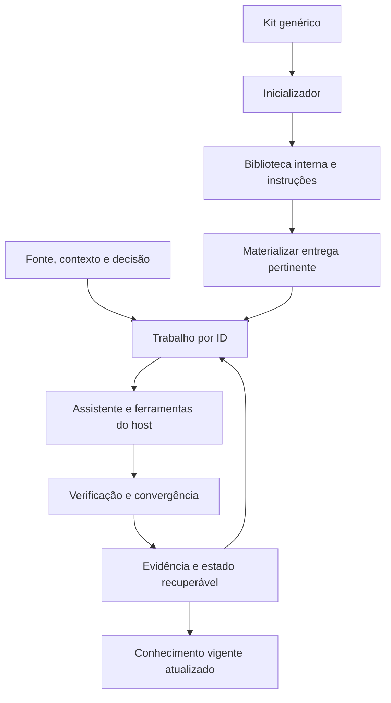
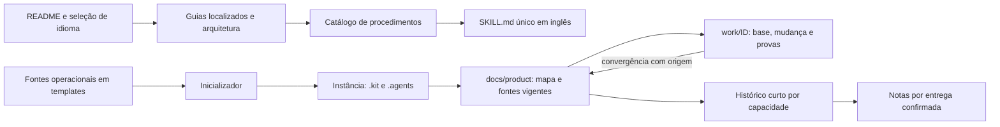
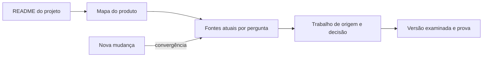

<!-- docs-nav:start -->
[English](../en/ARCHITECTURE.md) · Português (Brasil)

[Início](../../README.pt-BR.md) · [Índice da documentação](README.md)
<!-- docs-nav:end -->

# Arquitetura do kit local 0.1.0

O kit é um método assistido por arquivos com helpers determinísticos. Camadas:

| Camada | Conteúdo e responsabilidade |
|---|---|
| Distribuição | templates/, scripts/, licença e documentação genéricos |
| Instruções da instância | AGENTS, onze skills, fluxos, contratos, organização e ciclos |
| Biblioteca interna | .kit/templates e catálogo; materialização sem sobrescrita |
| Memória do projeto | Páginas atuais de funcionalidades, contexto, decisões e contratos compartilhados |
| Entrega identificada | docs/product/work/ID: brief, estado, handoff e artefatos pertinentes |
| Verificação | Conteúdo/resultado examinado pelo responsável e ferramentas da etapa; helpers conferem estrutura/hash |

Não existe daemon, executor de sessões novas, banco, sincronizador ou framework externo. Estado JSON não substitui os documentos de conteúdo. Hash identifica a versão da evidência, sem demonstrar verdade. .kit/scripts é portátil com a instância; os helpers requerem PowerShell 7.2+. Não há dependência Python/Node para o framework. Runtime do produto, web e renderização dependem do trabalho solicitado.

## Organização e equipe

Fundamentos por disciplina guardam conhecimento compartilhado, elaborados sob demanda. Trabalhos isolam perguntas/mudanças por identidade, com referências à origem/base e atualização dos consumidores. Diretórios não criam relações automaticamente. IDs e fontes responsáveis evitam specs concorrentes; não duplicar o conteúdo em relatório, backlog e resumo global.

Arquivos Markdown/JSON podem ser compartilhados e versionados no repositório. Para trabalho simultâneo, usar -Id explícito e branches/checkouts separados, revisando conflitos antes de juntar alterações; active_work é conveniência da instância, não atribuição pessoal. Helpers usam hash/trava para rejeitar leitura obsoleta em gravações cooperantes locais; não há coordenação distribuída ou transação de todos os arquivos. Selecionar não altera automaticamente a prioridade da equipe. Respeitar o método de gestão e integração já adotado, conforme [estrutura e colaboração](templates/engineering/structure-and-development.md).

Codex pode descobrir .agents/skills conforme seu cliente. Outros assistentes podem ler AGENTS/SKILLS e o procedimento escolhido; não prometer descoberta automática universal. O método também admite execução manual. Editor sem acesso aos arquivos requer fornecer material pertinente; não presumir memória automática da conversa.

## Estado e fechamento

Trabalho inicia com intenção/base e critérios, materializa só os documentos necessários e registra rodadas. Casos de progresso, falha, bloqueio, limite, repetição, cancelamento e conclusão são distintos. Retomada mantém histórico. Conclusão exige evidências atuais e registro de convergência, além da verificação do conteúdo; não publica produto nem comprova mercado.

execution_mode escolhe condução guided ou continuous. O estado do trabalho guarda etapa, etapas permitidas, alcance de parada, transições, pausas e retomadas. advance-stage registra passagem com evidência; não realiza a etapa nem julga seu conteúdo. Em continuous, o assistente continua apenas no alcance autorizado e salva uma retomada quando faltar informação indispensável ou atingir limite. Para voltar após encerrar a sessão, o host precisa receber novo pedido de execução.

Para nova alteração material, criar trabalho vinculado à base anterior e atualizar o conhecimento vigente. Scripts comparam hash lido sob trava curta antes de substituir estado/configuração; conflito exige reler e reconciliar. A verificação foi feita entre processos na mesma sessão Windows. Não cobre editores/Git, outras sessões/máquinas ou transação entre todos os arquivos. Usar um escritor por fonte sobreposta e revisão de integração; checkouts isolados reduzem sobreposição sem eliminar incompatibilidades de decisão.

## Distribuição e fontes

Os documentos de entrada na raiz distribuível são README.md, README.pt-BR.md, LICENSE, CONTRIBUTING.md e SECURITY.md. Os dois últimos são as fontes inglesas, com tradução em docs/pt-BR. Outros guias ficam em docs/en e docs/pt-BR, incluindo créditos e changelog. Templates guardam as fontes operacionais: SKILL.md únicos em inglês e guias/modelos em português. O catálogo traduzido resume as skills e abre a fonte integral; não mantém uma tradução completa de cada procedimento.

O [guia de continuidade](KNOWLEDGE.md) detalha essas relações. Mapa/histórico/notas são resultados escritos/revisados; não há gerador que infira o produto automaticamente. Os [procedimentos](process/SKILLS.md) orientam quem atualiza e quando. Referências de leitura são identificadas como tal para evitar confusão com entregas do produto.

## Entrada humana e versões examinadas

A consulta tem três níveis: README do projeto para contexto/uso, mapa em docs/product/README.md para localizar a fonte, e documento responsável para a definição. Histórico só entra quando a pergunta pede origem/mudança/prova. O mapa organiza por perguntas; disciplinas usam formatos próprios. A hierarquia funcional opcional não é o caminho dos componentes técnicos.

complete verifica hashes antes de capturar fontes mutáveis externas ao trabalho em work/ID/evidence/baselines/hash/arquivo.txt. O estado guarda original_path e digest; a regra vigente pode evoluir enquanto a prova encerrada continua verificável. preserve-evidence faz essa captura em trabalhos antigos concluídos, somente se as provas ainda coincidem. Não recupera bytes já perdidos, não salva todas as rodadas e não substitui Git/backups. Cópias são baselines de prova, não segundas fontes vigentes. Há custo de armazenamento e possibilidade de interrupção entre cópia/estado; um escritor por checkout continua necessário.
