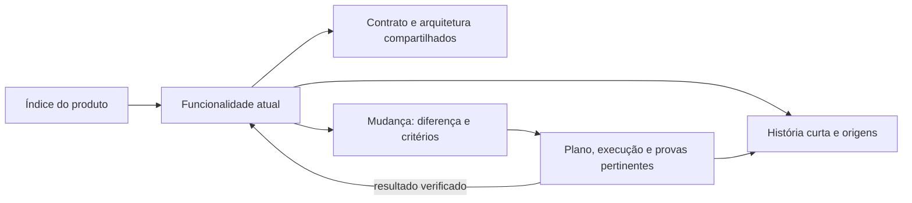

<!-- docs-nav:start -->
[English](../en/FEATURE_DOCUMENTATION.md) · Português (Brasil)

[Início](../../README.pt-BR.md) · [Índice da documentação](README.md)
<!-- docs-nav:end -->

# Onde consultar uma funcionalidade e suas mudanças

**A página da funcionalidade explica sua definição vigente, no estado declarado. A pasta da mudança explica o que tentamos alterar e o que realmente fizemos.** O índice do produto liga os dois.

## Comece pela funcionalidade

Em projeto novo, use uma página em features para reunir propósito, estado, regras/cenários, orientação de uso, limites e história curta. Ela aponta à arquitetura, design e provas, sem copiar esses documentos. Não criar manual, definição e spec atual separados por obrigação. Se o projeto já tiver boas fontes, manter seus endereços e linká-las no índice.

| Preciso encontrar… | Abro… |
|---|---|
| O funcionamento atual de remover/desfazer | features/item-removal.md |
| Uma nova proposta para esse recurso | work/persist-undo/spec.md |
| Abordagem e passos daquela mudança | plan.md e tasks.md na mesma pasta, quando necessários |
| O resultado e as verificações realizadas | verification.md e evidence/ da mudança |
| Por que a regra mudou | História curta da funcionalidade → mudança de origem/decisões |
| O conteúdo de uma versão entregue | delivery/release-notes.md, quando houver entrega |

Especificação é um documento de requisitos; execução é o trabalho de realizar/verificar. Funcionalidade é o comportamento oferecido, não o nome de uma atividade. Uma pesquisa pode terminar em uma decisão, sem implementar um recurso.

## Exemplo pequeno

```text
docs/product/
├── README.md                 índice: funcionalidades, contexto e mudanças
├── features/
│   ├── item-addition.md       adicionar: regra, uso e história
│   ├── item-completion.md     concluir/reabrir
│   └── item-removal.md        remover/desfazer
├── definition/product-behavior.md  contratos compartilhados e links às regras
├── brand/DESIGN.md           apresentação comum
├── engineering/architecture.md   implementação comum
└── work/
    ├── add-checklist/        intenção, spec/plano/tarefas pertinentes e provas
    └── persist-undo/         proposta futura para a mesma remoção
```

Esta árvore ilustra os papéis. Não inicializa nem implementa persist-undo. O piloto real ainda conserva IDs antigos nas origens, com rótulos de leitura descritivos. Em produto menor, essas funcionalidades podem ser seções de uma só página; não é necessário criar módulos.

## O que salvar na página atual

- **Propósito e estado:** para quem serve; proposta, protótipo, implementado ou disponível, conforme evidência.
- **Definição vigente:** requisitos, regras de negócio e critérios de aceite em cenários verificáveis, incluindo erros/limites que alterem o resultado; IDs já existentes são preservados.
- **Uso e relações:** como usar, o que depende de outros recursos/contratos e links a desenho técnico, design e provas pertinentes.
- **História curta:** data ISO, efeito, mudança de origem e versão/disponibilidade confirmada. Motivos detalhados ficam na mudança ou decisão responsável.

Essas informações podem ser títulos ou poucos parágrafos, não um formulário obrigatório. Regras que pertencem a contrato separado permanecem nele e são referenciadas. Dados privados/provas internas não são publicados automaticamente junto de um guia externo.

## Regras de negócio e critérios de aceite

**A decisão vigente pertence à página da funcionalidade.** O leitor não precisa reconstruí-la juntando todas as specs antigas. Por exemplo, em remover/desfazer, a regra é “somente a última remoção da sessão pode ser desfeita”; um critério verificável é “ao remover A e depois B, Desfazer restaura B e preserva seu estado”.

| Informação | Onde manter |
|---|---|
| Requisitos, regras de negócio e critérios de aceite que continuam valendo | Página da funcionalidade; contratos compartilhados são referenciados |
| Diferença proposta, critérios da mudança e regressões pertinentes | spec.md da mudança, ligada à definição consumida |
| Passou/falhou, versão, ambiente e prova do teste | verification.md e evidence/ daquela mudança |
| Motivo de uma escolha | Resumo útil na definição; detalhes na decisão ou mudança de origem |

Critérios vigentes descrevem resultados esperados, não um selo permanente de teste aprovado. Ao concluir uma mudança, incorporar seus novos requisitos/regras/cenários à definição responsável; guardar os resultados da execução na origem. Não copiar critérios de outra feature nem criar um cadastro de IDs por obrigação.

A página pode existir **antes do código**, com definição decidida e implementação pendente, se houver decisão registrada com sua autoridade/origem. Texto gerado não constitui aprovação. Propostas permanecem identificadas como propostas; uma decisão ainda não implementada é distinguida do comportamento disponível. “Vigente” significa a definição de referência no estado declarado, revisável por outra decisão rastreável.

## Especificar o conjunto e implementar depois

É possível definir várias funcionalidades do recorte conhecido antes de escrever código. Suas páginas são as especificações de referência: objetivo, regras, cenários, limites e dependências, com estado explícito. Não precisam terminar em um arquivo chamado spec.md para serem especificações; não manter outra cópia integral em work por obrigação.

Exemplo: um trabalho define-room-booking consolida cadastro de salas, reserva e cancelamento. Ele encerra pelos critérios documentais; as páginas continuam com definição decidida no contexto autorizado e implementação ausente. Implementar depois é outra entrega, implement-room-booking, com base documental recuperável e base técnica observada. Sua spec referencia a reserva e registra alcance, exclusões, dependências e resultados que deverão ser comprovados no software. Não inventar mudança de regra quando a intenção é realizar a definição existente.

| Momento | Funcionalidade | Trabalho e prova |
|---|---|---|
| Especificação em discussão | Proposta com dúvidas e cenários pertinentes | Discussão/pesquisa documental, sem aprovação presumida |
| Definição concluída | Definição decidida; código/disponibilidade ausentes | Critérios de especificação conferidos; origem e versão preservadas |
| Implementação selecionada | Mesma definição, reexaminada contra base/dependências atuais | Novo trabalho técnico ou continuação do alcance aberto; plano/tarefas pertinentes e critérios de execução |
| Implementação verificada | Estado/limites atualizados com provas; disponibilidade somente se confirmada | Resultados técnicos na origem; definição permanece consultável no mesmo endereço |

Uma entrega de ponta a ponta pode usar um só trabalho quando esse alcance estiver aberto e autorizado. Um trabalho já encerrado não é retomado para trocar seu objetivo documental por implementação. Antes de executar meses depois, conferir decisões alteradas, dependências, orçamento/restrições e código atual. Especificar todas as funcionalidades conhecidas não significa descobrir ou congelar todas as necessidades futuras.

## Identificar trabalhos e navegar o sumário

ID da pasta e título são diferentes. O helper recusa um ID existente; nomes distintos com intenção repetida podem coexistir, sem detecção semântica automática. Comparar base, objetivo, critérios e estado antes de criar outro. Usar efeito/contexto diferenciador ou um ticket/sufixo único quando necessário, por exemplo implement-room-booking-20261010-a. Data isolada não garante unicidade; apenas mudar maiúsculas/minúsculas não é identidade portátil. Preservar IDs antigos e explicitar relações no brief/índice, como implementa a definição, depende de ou substitui determinada decisão.

O índice pode ser um sumário com áreas e subáreas. Uma estrutura possível, sem níveis obrigatórios:

```text
Recursos
  Cadastro de salas
Agenda
  Reservas
    Reservar sala
    Cancelar reserva
```

Cada folha aponta à sua fonte responsável; títulos de grupo organizam leitura. Reserva depende do cadastro e cancelamento consome uma reserva, mas isso é uma relação explícita nas páginas, não uma inferência do sumário. Um recurso usado por vários grupos conserva uma fonte e recebe links dos consumidores. O índice informa estado sem repetir regras; dependências podem atravessar grupos ou estar decididas e ainda indisponíveis.

## Alterar a mesma funcionalidade novamente

Exemplo: hoje o desfazer só funciona na sessão; queremos preservá-lo após recarregar.

1. Ler item-removal e seus contratos de armazenamento/acesso. Guardar uma base recuperável.
2. Abrir uma mudança descritiva, como persist-undo. A spec diz o que será diferente e como aceitar o resultado; não reescreve a funcionalidade inteira.
3. Planejar, executar e verificar conforme risco. Guardar resultado/provas na mudança.
4. Atualizar a mesma página item-removal e contratos afetados após resultado demonstrado. Acrescentar sua linha de história e, se houver entrega, a nota correspondente.

Enquanto for proposta, o guia continua descrevendo a limitação atual. Esclarecimento dentro de uma mudança aberta não exige outra pasta; nova entrega material tem origem/base próprias. Uma correção trivial de texto pode usar o histórico Git sem todo o pacote.



## Crescer sem criar uma hierarquia obrigatória

```text
features/
├── events/
│   ├── registration.md       regra, uso e história da inscrição
│   └── cancellation.md       cancelamento com conteúdo próprio
└── communication/
    └── notifications.md      contrato consumido pela inscrição
```

Área/módulo agrupa leitura quando necessário. Uma página extensa pode ganhar subassuntos e um índice próprio; não gerar níveis vazios ou duplicar o mesmo recurso em cada equipe. Dependência é um link a comportamento/contrato consumido, não o parentesco da pasta. Frontend/backend descrevem implementação na arquitetura; não determinam a árvore do manual.

## Referências e limite da adaptação

[OpenSpec](https://github.com/Fission-AI/OpenSpec/blob/main/docs/concepts.md) separa specs atuais de mudanças e diferenças. [Spec Kit](https://github.com/github/spec-kit/blob/main/templates/commands/specify.md) reúne especificações por feature, com plano/tarefas associados. [BMad](https://docs.bmad-method.org/plan/break-work-into-stories-and-track-it/) preserva planos, critérios e evidências por trabalho. Adotamos a separação entre produto atual e histórico de mudança; estes caminhos e a combinação de regra/uso na página são escolhas locais, não layout oficial desses projetos.

Como exemplo concreto, a [spec do comando cli-spec no próprio OpenSpec](https://github.com/Fission-AI/OpenSpec/blob/main/openspec/specs/cli-spec/spec.md) reúne requisitos e cenários observáveis no mesmo arquivo. O [modelo de feature do Spec Kit](https://github.com/github/spec-kit/blob/main/templates/spec-template.md) também reúne requisitos e cenários de aceite, mas é um modelo, não prova de uma funcionalidade implementada. Aproveitamos essa estrutura de conteúdo sem importar uma árvore ou nomenclatura obrigatória.

O prefixo WRK dos pilotos foi uma convenção nossa de identificação. Não nomeia uma entidade nova, não é padrão de mercado e não é exigido pelo helper. Usar nomes descritivos para novas mudanças; não renomear provas concluídas apenas por estética.

O assistente/equipe escreve e revisa a documentação; helpers não a sincronizam semanticamente. Links válidos não provam compreensão por pessoas. [Organização](process/ORGANIZATION.md) define os destinos, [continuidade](KNOWLEDGE.md) detalha preservação, e [cenários](USE_CASES.md) explica entradas parciais e reuso.
