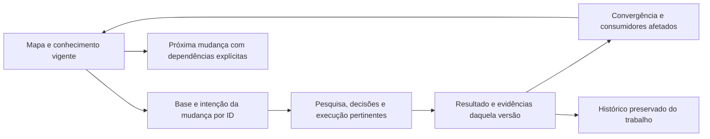
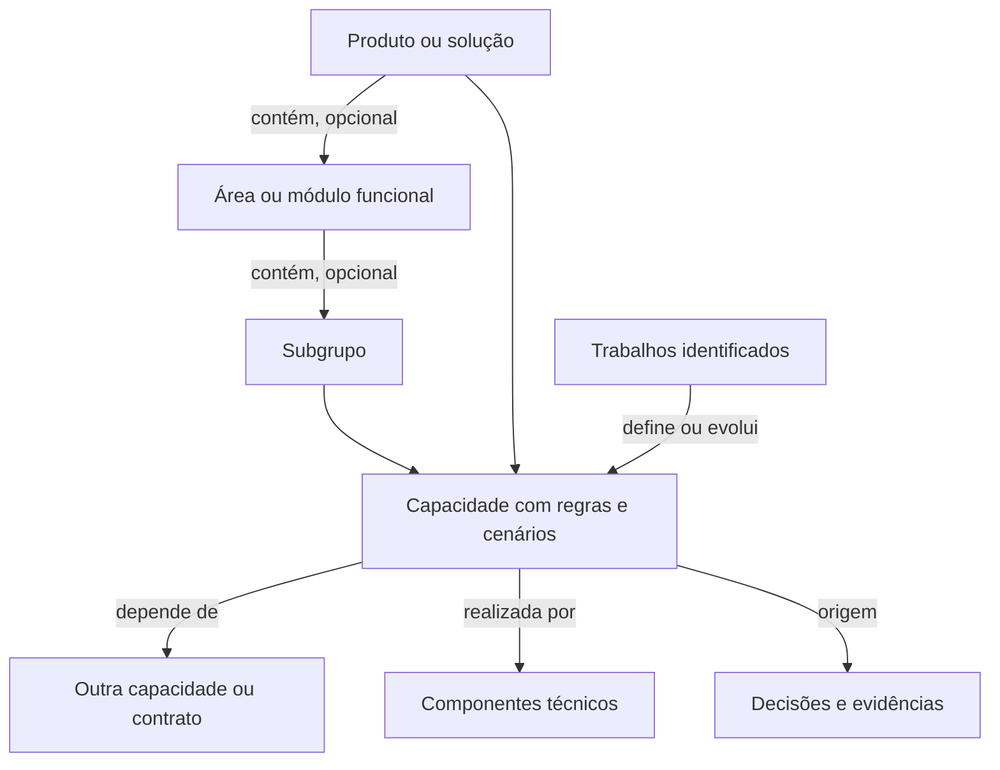

<!-- docs-nav:start -->
[English](../en/KNOWLEDGE.md) · Português (Brasil)

[Início](../../README.pt-BR.md) · [Índice da documentação](README.md)
<!-- docs-nav:end -->

# Trabalhos, conhecimento vigente e evolução

Cada trabalho responde uma pergunta ou entrega uma mudança delimitada. Pode atravessar pesquisa, decisão, design, implementação e verificação pertinentes à mesma intenção. Não é preciso abrir uma pasta por etapa nem reduzir toda funcionalidade a uma tarefa por arquivo. Uma mudança maior pode consumir resultados de vários trabalhos.

## Onde consultar

| Local na instância | Pergunta que responde | Manutenção |
|---|---|---|
| docs/product/README.md | O que existe hoje, em qual estado, e onde está documentado? | Índice de fontes e trabalhos, atualizado conforme resultados |
| docs/product/context/ | Por que fazemos isso, quais princípios e pendências existem? | Contexto vigente e registro de artefatos |
| docs/product/definition/product-behavior.md, quando necessário | Qual comportamento atual orienta a próxima mudança? | Regras com IDs, estado, origem, contratos e limites; pode ser dividido por domínio |
| experience, brand, engineering, operations etc. | Quais fluxos, design, arquitetura e operação estão vigentes? | Uma fonte por assunto/regra; criar só quando houver conteúdo pertinente |
| docs/product/work/ID/ | O que foi pedido, decidido, feito e verificado naquela mudança? | Base, diferenças, decisões, tarefas, evidências e handoff daquela versão |
| .kit/ | Como o método funciona e quais modelos estão disponíveis? | Instruções e biblioteca genérica, sem ser a documentação do produto |
| .agents/skills/ | Qual procedimento conduz esta pergunta? | Onze procedimentos; não são históricos nem documentos finais |

A especificação de uma mudança descreve sua intenção/diferença em relação à base; o vigente orienta o produto hoje. Um trabalho encerrado não deve ser reescrito para representar todas as versões futuras. Enquanto uma regra só tiver uma fonte responsável, o mapa pode apontar a ela; consolidar por domínio quando várias mudanças tornarem essa consulta dispersa. Não criar um PRD monolítico que repita todos os arquivos.

## Como atualizar sem perder a origem

1. Ler mapa, fontes afetadas e pendências relevantes. Identificar resultado/contrato consumido e sua versão, além da dependência entre trabalhos.
2. Fixar base, escopo, critérios e intenção. Pesquisas e propostas são identificadas como tais; não implicam aprovação ou implementação.
3. Elaborar os artefatos necessários dentro do trabalho. Registrar decisões e evidências recuperáveis; verificar o resultado proporcionalmente.
4. Na convergência, identificar diferenças e consumidores. Incorporar ao vigente somente resultados/decisões pertinentes, com estado real e origem por ID.
5. Atualizar mapa, registro e documentos afetados. Preservar provas da versão anterior. Corrigir links errados com motivo; histórico não exige manter uma relação falsa.

Uma evidência técnica pertence à versão examinada. Se um arquivo usado como prova for alterado, não trocar seu hash para fingir a mesma verificação: preservar um snapshot identificado ou executar a verificação pertinente e registrar nova evidência. O helper detecta alterações, mas não julga equivalência semântica.

## Exemplo: lista local

A entrega inicial da lista implementou inclusão, conclusão/reabertura, remoção/desfazer e persistência. O mapa aponta ao comportamento atual, DESIGN, arquitetura, uso e às provas desse trabalho. A documentação da implementação continua disponível mesmo quando outro trabalho se torna ativo.

Se uma mudança futura adicionar edição de texto, sua base aponta ao comportamento e à versão anteriores. A análise verifica impacto em identidade, validação, foco e persistência; tarefas e provas referenciam esses critérios. Somente depois de implementar e verificar no escopo, o vigente passa a descrever edição de texto, com a nova origem. A mudança anterior continua registrando a entrega anterior. Este exemplo não afirma que a edição já existe.

## Capacidade não é trabalho

Uma capacidade é parte do que a solução permite fazer; um domínio reúne regras relacionadas. Um trabalho define, testa, implementa ou altera uma parte dessa solução. Uma mesma capacidade pode receber várias mudanças ao longo do tempo, sem ganhar várias definições vigentes concorrentes.

Começar com poucos documentos responsáveis. Quando várias mudanças dificultarem a consulta, usar páginas em features/<nome>.md para reunir regras, uso e história; acrescentar links a UX, design, arquitetura/contratos e provas. Não criar outra árvore de capacidades nem exigir spec/manual atuais separados. Relações transversais continuam nos documentos responsáveis. A pasta do domínio não precisa imitar a pasta do código.

Na mudança, registrar base e diferenças: adicionar, alterar ou remover requisito identificado. Não repetir todo o vigente. Pesquisa usa hipótese/alegação; decisões usam ID/contexto/alternativas/motivo; implementação aponta requisitos e contratos; verificação registra versão/resultado/limites. Cada origem permanece recuperável. Um índice ou resumo só aponta a essas fontes.

## Dependências, retomada e limites

Registrar dependências no plano/spec e no mapa quando ajudam a consulta: fonte, contrato/resultado, versão exigida, razão e estado. Uma pesquisa pode desbloquear uma decisão; uma funcionalidade pode depender de um contrato implementado. Não inferir dependência por data, número ou proximidade da pasta. active_work seleciona o trabalho do checkout, sem apagar o restante nem ordenar a prioridade da equipe.

Indicar disponibilidade necessária na etapa consumidora e disponibilidade observada: uma proposta pode orientar design; executar uma integração exige o contrato implementado ou uma simulação explicitamente limitada. Dependência ainda ausente vira pendência/bloqueio daquela ação, não uma confirmação fictícia. Concluído em pesquisa não significa implementado no produto.

Decisões ficam em uma fonte identificada, referenciada pelos consumidores. Quando houver substituição, conservar motivo/base e relacionar a sucessora; a documentação atual aponta à decisão vigente. Não criar um log global com cópia de toda decisão já registrada no trabalho. Para uma mudança trivial, a atualização de uma fonte existente pode ser suficiente.

Documentação destinada ao usuário, integrador ou operador é elaborada quando houver esse consumidor. Um tutorial ensina, um guia orienta uma tarefa, uma referência descreve contratos, e uma explicação esclarece motivos. Não criar quatro árvores vazias nem publicar automaticamente material interno. Se a mudança afetar um guia já existente, revisá-lo junto à entrega.

A documentação evolui por autoria e revisão explícitas do assistente/equipe. Scripts materializam modelos e controlam registros; não produzem automaticamente uma especificação correta nem sincronizam módulos. Revisão de documentação faz parte da entrega, não é publicação automática nem requisito de gerar todos os modelos.

Referências verificadas em 06/10/2026: [Spec Kit](https://github.github.io/spec-kit/reference/core.html) para contexto selecionado por feature; [OpenSpec](https://github.com/Fission-AI/OpenSpec/blob/main/docs/overview.md) para separar especificações vigentes e diferenças propostas; [ADRs](https://adr.github.io/) para registrar razões de decisões; [arc42](https://arc42.org/overview/) para vistas de arquitetura; [Diátaxis](https://diataxis.fr/) para necessidades de leitura. Nossa adaptação mantém poucos documentos e atualização explícita, sem instalar esses frameworks nem prometer equivalência operacional.

Veja [organização](process/ORGANIZATION.md), [ciclos](process/WORK_CYCLES.md), [mapa de referência](templates/README.md) e [comportamento de referência](templates/definition/product-behavior.md).

## Produto, capacidades, agrupamentos e implementação

Usamos “capacidade” ou “funcionalidade” para descrever o que a solução permite fazer, conforme o vocabulário do domínio. Não exigimos duas entidades, cadastros ou níveis distintos para esses termos. Área/módulo funcional é um agrupamento opcional para consulta. Componente técnico é uma parte da implementação. Esses nomes são convenções locais, não uma taxonomia universal: em serviço/evento, usar o vocabulário do domínio e descrever o resultado oferecido.

Produto → grupo opcional → capacidades organiza a leitura. Não criar módulos fictícios nem uma pasta para cada requisito. Uma capacidade pode atravessar componentes e depender de outra capacidade; uma mudança pode afetar várias delas. Registrar essas relações por links/IDs, não duplicando a definição em cada grupo. Reagrupar preserva identidade/origem e atualiza consumidores com motivo.

No piloto, adicionar, concluir/reabrir e remover têm páginas atuais que reúnem regras, uso e história. Persistência e interação permanecem contratos compartilhados, ligados pelas páginas. As ações atravessam app/core/armazenamento sem exigir três módulos. Edição futura seria uma nova mudança com impacto explícito nessas fontes/contratos; ainda não existe.

Para retomar com segurança, a base precisa ser recuperável: commit/tag quando houver ou snapshot/arquivos com versão/data. Verificar divergências da implementação atual antes de consumir prova antiga. É possível redefinir a ideia, mas a decisão registra o motivo, a origem e o que deixa de valer.

## Histórico por capacidade e notas de entrega

Histórico significativo fica na definição da capacidade, com data ISO, IDs afetados, tipo/efeito, revisão/base recuperável, trabalho/decisão/prova e versão/data da entrega ou “ainda não entregue”. Não copiar o diário inteiro da execução. Uma mudança pode afetar várias capacidades; registrar links de origem em cada fonte afetada quando necessário. Em produto pequeno, uma tabela no comportamento vigente é suficiente; não criar outro arquivo de log para cada requisito.

Versionar o produto normalmente basta. Uma capacidade registra em qual versão mudou e a revisão que define a regra; versão independente faz sentido para pacote/API/contrato distribuído de forma independente. Escolher isso exige contexto, não uma regra universal. Datas permitem consulta por período e a release reúne os trabalhos efetivamente disponíveis ao público/ambiente declarado, incluindo limites/migração pertinentes. Pesquisa concluída ou tarefa marcada não vira lançamento.

[Notas de entrega](templates/delivery/release-notes.md) são elaboradas quando necessárias. A prática se inspira conceitualmente em [Keep a Changelog](https://keepachangelog.com/en/1.1.0/) e na consolidação por mudanças do [Towncrier](https://towncrier.readthedocs.io/en/stable/tutorial.html). Não copiamos modelos nem instalamos executores. Aproveitamos o trabalho identificado já existente, sem exigir outro fragmento/changelog por solicitação. A autoria e o filtro por período continuam assistidos/manuais.

## Agrupamento e crescimento proporcionais

Área/módulo pode conter subgrupos e reunir capacidades quando o domínio pedir. Começar com títulos e links no mapa; não impor níveis fixos, uma pasta por nó ou duplicar uma capacidade em vários grupos. Dividir uma fonte quando a consulta, responsabilidade ou risco exigir, mantendo IDs e autoridade. Regras e cenários podem ficar juntos. Uma solução simples pode ter só mapa e comportamento; uma complexa pode ter índices por domínio ligados a definições responsáveis.

Separar três relações: **contém** organiza navegação; **depende de** identifica resultado/contrato, versão e disponibilidade; **é realizado por** conecta comportamento à implementação. Uma árvore não substitui dependências transversais. Componentes técnicos podem ter decomposição própria na arquitetura, sem obrigar que módulos funcionais coincidam com serviços/pacotes. Reorganização registra motivo e atualiza links/consumidores, preservando identidade e origem.

A decomposição recursiva e seletiva do [arc42](https://docs.arc42.org/section-5/) é uma referência de arquitetura; as abstrações do [C4](https://c4model.com/abstractions) descrevem estrutura técnica. O [OpenSpec](https://github.com/Fission-AI/OpenSpec/blob/main/docs/concepts.md) admite agrupamentos lógicos de specs. Nossa separação entre navegação funcional, dependência e implementação é uma escolha do kit, não adoção de uma hierarquia universal. Verificados em 06/10/2026.

O endereço físico organiza por assunto; a leitura começa pelas perguntas do mapa. Marca usa posicionamento/voz; comportamento usa regras/cenários; arquitetura usa responsabilidades/contratos. Não precisam ter o mesmo formato. Veja o [roteiro de uso](GUIDE.md) para descobrir onde ler e salvar.

## Preservação ao encerrar

Enquanto o trabalho está ativo, alteração da evidência invalida o fechamento até haver nova conferência/registro. Na conclusão, o helper captura byte a byte as fontes de prova fora da pasta do trabalho (definições atuais, código etc.) em evidence/baselines, retendo hash e original_path. Assim, a próxima evolução do vigente não invalida a prova daquela versão. O snapshot é material histórico identificado, não a navegação atual ou demonstração de que a versão futura foi testada.

Para trabalho antigo já concluído, usar `-Action preserve-evidence -Id change-id` **antes** de alterar fonte ainda ligada às provas. O helper exige que os hashes antigos ainda confiram; não recupera bytes perdidos, não muda digest para fingir verificação e não reabre critérios/conclusão. Provas dentro do trabalho continuam preservadas em seu destino. Isso protege fontes usadas nos critérios/convergência atuais; não reconstrói versões de todas as rodadas anteriores. É uma escolha local, sem transação multiusuário; snapshots ocupam espaço e não substituem Git/backups.

## Consulta por funcionalidade

O [guia específico](FEATURE_DOCUMENTATION.md) distingue especificação vigente, diferenças da mudança, execução e manual. Uma funcionalidade normalmente conserva seu endereço de consulta entre entregas; novas alterações materiais têm trabalho/base próprios. Reorganização justificada pode mover a fonte com identidade/origem preservadas, mapa/consumidores atualizados e apontador antigo quando útil, conforme [organização](process/ORGANIZATION.md). Use página ou seção quando suficiente, capítulos por área quando a navegação justificar. Novas mudanças usam nomes descritivos; os IDs históricos não identificam funcionalidades.
