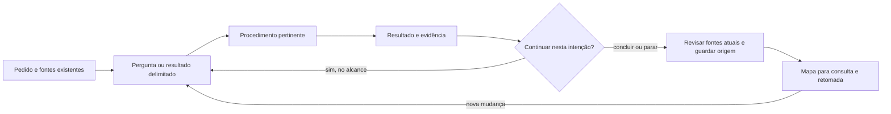

<!-- docs-nav:start -->
[English](../en/USE_CASES.md) · Português (Brasil)

[Início](../../README.pt-BR.md) · [Índice da documentação](README.md)
<!-- docs-nav:end -->

# Cenários de uso e reuso

Este guia ajuda a escolher uma entrada e acompanhar onde fica o resultado. Cenários são exemplos hipotéticos e roteiros de inspeção, não entrevistas, experimentos executados ou certificação de todas as etapas. [Guia](GUIDE.md), [fluxos](process/WORKFLOWS.md) e [consulta por funcionalidade](FEATURE_DOCUMENTATION.md) mantêm as instruções responsáveis; esta página não é outro executor.

## Percurso completo, sem preencher todas as pastas

Exemplo hipotético: uma equipe precisa organizar inscrições de uma oficina. A aposta inicial é que a confirmação manual perde informações. Antes de construir um sistema, escolher o que investigar e qual pequeno resultado permitirá decidir.

| Passagem | Resultado útil e onde consultar | Condição para a próxima ação |
|---|---|---|
| Ideia e pesquisa | Contexto, pergunta, fontes e contraevidência; context/idea e pesquisa responsável | Sinais suficientes para delimitar uma aposta; demanda continua hipótese sem observação apropriada |
| Problema, viabilidade e MVP | Público candidato, alternativa atual, experimento e restrições; definition/business | Escolher a menor prova da incerteza. Operação manual pode bastar; não presumir necessidade de software |
| Experiência | Inscrever, confirmar, cancelar, falhas/acesso; fluxos/protótipo | Representação revisável e critérios pertinentes; sem alegar teste com usuários não realizado |
| Marca/visual | Voz ou contrato visual proporcional, quando afetam a entrega | Não exigir identidade completa para testar compreensão de um formulário |
| Engenharia | Comparação de soluções locais, dados, acesso, custo e manutenção; fontes técnicas | Se código for necessário/autorizado, ter base, critérios e riscos tratáveis. Prova técnica pode antecipar detalhe visual |
| Entrega pequena | Mudança delimitada, spec/plano/tarefas necessários, verificações reais | Corrigir lacunas e consolidar regras/guias atuais; marcar disponível somente no ambiente confirmado |
| Piloto/operação | Plano e, quando executado, episódios/resultados e limites | Decidir continuar, revisar ou parar; planejar não autoriza publicar/contatar pessoas |
| Evolução | Nova pergunta/mudança ligada à base e às fontes afetadas | Reutilizar o conhecimento atual e preservar a origem anterior |

O mesmo trabalho pode atravessar etapas pertinentes à sua intenção. Apostas/entregas distintas podem ter trabalhos ligados entre si. Roadmap prioriza resultados; não é a lista de modelos a gerar. Se a investigação descartar a hipótese, registrar conclusão e motivo, revisar os consumidores e encerrar sem produzir arquitetura fictícia.

## Usar cada procedimento isoladamente e voltar a ele

Leitores hipotéticos: idealizador iniciante, pesquisador, designer, pessoa de engenharia, responsável por operação e mantenedor. A coluna de reuso é o que muda ao voltar, não uma etapa extra. Os documentos citados são destinos/IDs do [catálogo](process/CATALOG.md), elaborados somente quando pertinentes. Procedimentos completos estão em [SKILLS](process/SKILLS.md).

| Procedimento | Primeira entrada | Reuso / confronto | Resultado consultável |
|---|---|---|---|
| guide-product | “Tenho esta ideia; qual a próxima pergunta?” | Retomar após pausa, entrar em produto existente ou mudar alcance; ler base/pedido antes de selecionar etapa | Mapa, idea, principles, open-questions, artifact-register e handoff pertinentes |
| research-product | “As alternativas já resolvem este problema?” | Nova fonte contradiz premissa: verificar origem/data, atualizar conclusão e consumidores sem repetir toda pesquisa | desk-research reutilizável ou research da mudança; evidence-review quando necessário |
| assess-feasibility | “Qual experimento cabe na capacidade disponível?” | Teto de custo/tempo muda: comparar recorte/manual/adiamento e revisar aposta; não inventar orçamento | problem-and-value, experiments-and-mvp, feasibility, capacity-costs-and-evolution |
| design-experience | “Como alguém completa esta tarefa?” | Revisar cancelamento, perda de acesso ou erro com regras existentes; não redesenhar tudo | flows-and-prototype, design-and-accessibility-review; cenários/critério na spec quando pertinente |
| define-brand-design | “Que direção e linguagem servem esta proposta?” | Corrigir contraste/estado de um componente preservando posicionamento; conferir consumidores e material renderizado | brand e DESIGN; direção escrita não prova qualidade visual |
| plan-engineering | “Como atender estes requisitos localmente?” | Avaliar projeto existente, integração ou limite técnico observado; confrontar alternativas e escolha do usuário | existing-project-assessment, constraints-and-quality, architecture, technologies, decisions-and-technical-review, diagrams, structure-and-development, dependencies-and-infrastructure |
| review-security | “Quem pode acessar/publicar estes dados?” | Revisar nova fronteira, contrato ou dependência; distinguir ameaça proposta de falha comprovada e controle testado | security-and-privacy, requisito/tarefa corretiva e verification responsável |
| deliver-slice | “Implemente esta pequena entrega local” | Corrigir falha reproduzível ou alterar o mesmo recurso: ler atual, fixar base e verificar regressão relevante | spec, plan, tasks, consistency, verification, convergence no trabalho, conforme necessidade; mapa/guias atualizados |
| evolve-product | “Como executar e observar um piloto?” | Relato/incidente ou resultado real vira pesquisa, correção ou melhoria com origem; release exige disponibilidade confirmada | launch-and-operations, roadmap-and-management, decisions-and-changes e release-notes pertinentes |
| challenge-assumptions | “Confronte esta decisão antes de investir” | Reexaminar arquitetura/UX/demanda quando evidência muda; crítica não implementa silenciosamente outra solução | critical-review ou decision da mudança com razões/evidências e consumidores |
| maintain-knowledge | “Onde está a regra atual? Os documentos divergem” | Consolidar outra entrega do mesmo recurso, mover capítulo ou reparar vínculo; preservar prova antiga | Fonte responsável corrigida, mapa/história e convergência; sem manual inteiro por mudança |

Não existe obrigação de acionar todos. Uma revisão de contraste pode usar experiência, DESIGN e verificação; uma pesquisa pode terminar sem código; engenharia pode começar num produto existente sem refazer marca ou persona. Em uma correção, número de linhas não decide profundidade: impacto, incerteza e verificabilidade orientam o registro.

## Recursos transversais: cenários que costumam revelar falhas

| Situação | Uso/reuso e resultado esperado | Limite a conferir |
|---|---|---|
| Instância nova ou documentação já existente | Inicialização enxuta em destino novo; em legado, mapear/linkar fontes existentes antes de adaptar a organização | O inicializador não é migrador de repositórios; não sobrescrever nem duplicar o manual |
| Arquivo ainda não existe | Consultar catálogo; materializar só o documento que responde à pergunta e substituir estado de modelo por resultado real | materialize preserva arquivo existente; não pesquisa, traduz nem conclui etapa |
| Troca de idioma/cliente de IA | Nomes técnicos estáveis; narrativa segue output_language; ler a skill se o cliente não a descobrir | Não renomear trabalho nem supor tradução/discovery automática; documentação pública tem pares EN/PT |
| Modo contínuo e interrupção | Definir alcance/critério/limite; registrar rodadas/passagens, pausa/razão/próximo passo; retomar após pedido | Não há daemon ou continuação após terminar a sessão; resposta indispensável ausente impede só ação dependente |
| Trabalho encerrado selecionado | Ler seu resultado como histórico; nova entrega material recebe ID/base próprios e a mesma página de funcionalidade | active_work não significa pendência ou prioridade; não reexecutar trabalho concluído |
| Sem progresso, hipótese descartada ou cancelamento | Registrar causa/conclusão, preservar achados e parar/rever estratégia; corrigir consumidores da conclusão anterior | Não reduzir critérios nem repetir texto para simular avanço |
| Fonte ou regra mudou | Reexaminar alegação e consumidores; guardar versão pertinente. complete captura provas externas ao trabalho; legado íntegro usa preserve-evidence antes de editar | Hash comprova bytes, não verdade. Rascunho descartável pode sumir; fonte/evidência decisiva não deve existir só em scratch ignorado |
| Mesmo recurso, outra entrega | Consultar regra/guia atual → nova diferença → verificar → atualizar a mesma fonte/página, ligada ao novo trabalho | Spec histórica não se torna manual de todas as versões; tutorial/contrato não precisam repetir conteúdo |
| Frontend/backend ou vários repositórios | Referenciar contrato responsável, versão/revisão consumida e disponibilidade; estabelecer atualização dos consumidores | Link local válido não garante acesso em outra máquina. Sem regra de sincronização, nova cópia não resolve o problema |
| Dois responsáveis simultâneos | Usar IDs/checkouts/branches e revisar consolidação do conhecimento compartilhado | Um active_work por checkout; helpers não coordenam gravações concorrentes. Não alegar suporte multiusuário transacional |
| Entrega/release e distribuição do kit | Distinguir implementado/disponível, consolidar notas pertinentes; pacote genérico mantém licença/créditos | Trabalho concluído não publica produto. Dados privados de instâncias não acompanham distribuição pública |

Para comandos e contratos usar [ciclos](process/WORK_CYCLES.md), [organização](process/ORGANIZATION.md), [idioma](LANGUAGE.md) e [créditos](CREDITS.md). IDs de materialização vêm do catálogo; etapas de execução vêm do contrato do helper. Não presumir que todo nome de agrupamento aceita o mesmo parâmetro.

## O que foi demonstrado e como explorar os próximos cenários

No piloto da lista, entrega inicial e posterior melhoria documental apontam ao mesmo recurso Remover/desfazer. A oficina documental mostra alteração de uma proposta sem afirmar implementação. São exemplos de consulta/continuidade examinados, não demonstração de toda a tabela ou validação humana.

Para explorar outro cenário, escolher pergunta/pessoa/base, seguir entrada → fonte atual → procedimento → saída → consumidores, e registrar obstáculos no trabalho/revisão pertinente. Executar ferramentas somente quando isso verifica o resultado pedido. Não criar uma instância, relatório ou teste automatizado por linha desta tabela.

Teste futuro com leitor sem orientação: localizar uma regra atual, distinguir proposta de disponibilidade, descobrir por que ela mudou e preparar uma alteração sem reescrever provas antigas. Registrar tentativa e dificuldade observadas; corrigir apenas lacunas demonstradas. A inspeção do autor não substitui esse teste.
