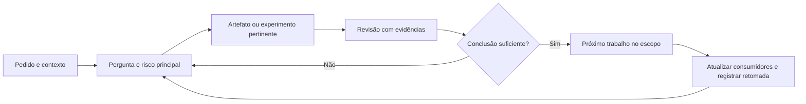

<!-- docs-nav:start -->
[English](../../en/process/STAGE_CONTRACTS.md) · Português (Brasil)

[Início](../../../README.pt-BR.md) · [Índice da documentação](../README.md)
<!-- docs-nav:end -->

Referência de leitura; fonte operacional: `templates/.kit/STAGE_CONTRACTS.md`. Esta página não é uma skill instalada nem uma entrega elaborada do projeto.

# Passagens e retomada do fluxo local

Processo 0.1.0. Não há execução automática, aprovação compulsória nem obrigação de completar todos os modelos. Escolher uma pergunta, aproveitar o que já existe e registrar o resultado. Os procedimentos são independentes e incluem seus próprios contratos.

| Trabalho | Entrada necessária agora | Saída suficiente para avançar | Não antecipar sem motivo |
|---|---|---|---|
| Descobrir | Situação/problema candidato, intenção, fontes e restrição decisiva | Pergunta investigável, hipótese e desconhecidos | Stack, telas completas, cronograma total |
| Pesquisar | Pergunta que muda uma decisão, evidência existente | Síntese com fonte/limite/contraevidência e recomendação | Entrevistas fictícias, pesquisa ilimitada |
| Delimitar aposta | Sinais, alternativa atual, capacidade pertinente | Resultado, público candidato, não objetivos, risco e experimento | Mercado validado ou receita presumida |
| Prototipar | Jornada/regras relevantes e dúvida de uso | Representação revisável, estados, protocolo e achados quando executado | Marca final para testar uma interação simples |
| Escolher marca/visual | Uso/público e identidade existente | Contrato visual proporcional e exemplos inspecionados | Todas as telas/tokens antes de decidir direção |
| Planejar engenharia | Comportamento/qualidade, capacidade e risco técnico | Alternativas, decisão/pendências, contratos e prova quando necessária | Cache, microserviços, provedor público por hábito |
| Implementar fatia | Escopo solicitado, baseline e critérios observáveis | Comportamento verificado, limites e conhecimento atualizado | Publicação ou contratação automática |
| Piloto/operação | Entrega demonstrável, audiência, acesso e suporte | Resultados, falhas, custo e decisão da aposta | Métricas fabricadas ou aprovação pelo checklist |
| Evoluir | Relato/métrica/incidente/mudança com origem | Impacto, atualização do vigente e verificação pertinente | Repetir descoberta inteira |

Se faltar informação, perguntar somente quando muda a próxima ação; registrar outras lacunas com condição de revisão. Não bloquear um wireframe por orçamento de hosting desconhecido. Antecipar privacidade, offline ou limite de investimento se inviabilizam a aposta. Não adiar autorização/acesso para depois do desenho dos fluxos afetados.

No encerramento registrar: resultado real, estado (proposto/observado/decidido), arquivos responsáveis, pendências e próxima ação com sua condição. Atualizar current_phase em .kit/project.json só para refletir o contexto geral; a etapa do trabalho identificado fica em state.json.execution.current_stage. Nenhum desses campos comprova aprovação. Retomada lê esse registro e a solicitação atual, não reexecuta todas as etapas.

Revisões podem voltar à origem. Se a regra muda, identificar consumidores na fonte/mapa responsável ou, quando necessário, em docs/product/context/artifact-register.md; corrigir o vigente e identificar o histórico. Prova técnica pode preceder detalhamento visual; teste de protótipo pode devolver o trabalho à definição do problema.

Detalhes: [coleta progressiva](STAGE_INFORMATION.md), [MVP/experimentos](../templates/definition/experiments-and-mvp.md), [revisão de design](../templates/experience/design-and-accessibility-review.md) e [contrato de fatia](WORK_CONTRACT.md).

Aplicar [organização](ORGANIZATION.md), [catálogo](CATALOG.md) e [ciclos](WORK_CYCLES.md): materialização pertinente, trabalho ativo explícito, precondições, consistência, TDD contextual e confronto final. Presença de arquivo não demonstra conteúdo suficiente. Scripts usam PowerShell 7.2+.
