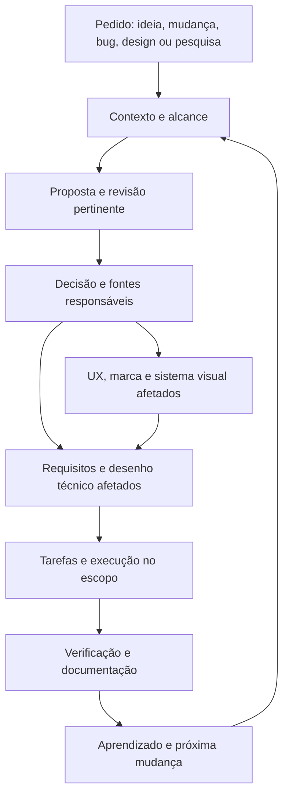

<!-- docs-nav:start -->
[English](../../en/process/WORKFLOWS.md) · Português (Brasil)

[Início](../../../README.pt-BR.md) · [Índice da documentação](../README.md)
<!-- docs-nav:end -->

Referência de leitura; fonte operacional: `templates/.kit/WORKFLOWS.md`. Esta página não é uma skill instalada nem uma entrega elaborada do projeto.

# Entradas e integração entre etapas

Usar [contratos de etapas](STAGE_CONTRACTS.md) para o que consumir, entregar, adiar e salvar na retomada. A ordem depende da incerteza e alcance, não do número da pasta.

Versão do processo 0.1.0. Fluxo local independente. Entrada depende do pedido atual, work_type e estado do produto. Não é preciso começar sempre pela ideia. Selecionar procedimentos locais no [mapa de skills](SKILLS.md); ferramentas/especialistas pessoais não são pré-requisito dos roteiros.

| Entrada | Primeiro trabalho | Etapas pertinentes | Resultado |
|---|---|---|---|
| Ideia/produto novo | Contexto, problema e desconhecido principal | Pesquisa → crítica → produto/negócio → UX/design → engenharia/entrega conforme aposta | Próxima aposta justificada, não aprovação integral |
| Nova funcionalidade | Ler produto/código/specs existentes e base/versionamento; entender resultado solicitado | Proposta e impacto → pesquisa/crítica se incerteza → spec/UX/design/arquitetura afetados → tarefas/verificação | Mudança delimitada com documentos consumidores atualizados |
| Correção | Esperado vs observado, reprodução e impacto | Diagnóstico → causa/evidência → correção delimitada → regressão/verificação | Sintoma original conferido e causa tratada; não redesign amplo por padrão |
| Design/UX/marca | Problema de experiência e materiais existentes | Fluxos/regras → alternativas → revisão visual → tokens/copy/implementação quando no escopo | Decisão visual/experiência e evidência apropriada |
| Arquitetura/refatoração | Requisito de qualidade ou limite demonstrado | Alternativas/prova técnica → decisão técnica → contratos/dados → tarefas/verificação | Mudança técnica proporcional e condições de revisão |
| Pesquisa | Pergunta que está impedindo decisão | Fontes/protocolo → síntese/evidência contrária → recomendação | Resposta com limites ou experimento seguinte |

Mesmo em produto sem código, uma funcionalidade pode ser discutida como mudança da proposta. Registrar “planejado”, sem assumir comportamento implementado.

## Definir várias funcionalidades e implementar depois

É possível especificar todas as funcionalidades do recorte conhecido sem iniciar código. Começar pelo mapa e elaborar as fontes responsáveis em features, ou documentação existente indicada no mapa: objetivo, regras, cenários, limites e dependências. Registrar propostas, decisões com origem/autoridade e lacunas; não tratar o conjunto como completo para sempre. Uma intenção documental pode abranger várias funcionalidades; não é necessário abrir um work por página.

Há dois percursos legítimos. Em uma entrega de ponta a ponta autorizada, o mesmo work pode atravessar definição, engenharia e implementação, com critérios para esse alcance. Quando o pedido termina na especificação, encerrar o work pelos critérios documentais e manter as funcionalidades como definidas e não implementadas. Para implementar depois, abrir outro work ligado à definição; não retomar um work concluído nem reutilizar seus critérios documentais como provas de software.

Exemplo: define-room-booking conclui regras/cenários de reserva em features/reservations/booking.md; implement-room-booking realiza esses requisitos posteriormente. A nova spec pode apontar à definição em vez de copiá-la ou inventar alteração de regra: a diferença agora é entre comportamento definido e estado técnico ainda ausente/parcial. Identificar a base documental recuperável e a base técnica observada, dependências realmente disponíveis, alcance, critérios de execução e regressões. Plano/tarefas surgem conforme a implementação selecionada precisar. Implementar outras funcionalidades repete essa seleção, não toda a descoberta.

Na retomada, conferir se a definição e as dependências mudaram desde o planejamento. Decisão documental não autoriza desenvolvimento/publicação por si; atraso entre etapas pode exigir revisar premissas ou plano. Encerrar definição não muda disponibilidade no índice.

Coleta de informações é progressiva: seguir [informações por etapa](STAGE_INFORMATION.md), reutilizando saídas anteriores e perguntando apenas por lacunas relevantes. Planejamento, protótipos, implementação e verificações podem ocorrer localmente conforme [estrutura e desenvolvimento](../templates/engineering/structure-and-development.md), sem obrigar publicação ou CI remoto. Escopo autorizado e critérios pertinentes continuam necessários.

## Fluxo de nova funcionalidade

1. Contextualizar o resultado e identificar baseline dos requisitos/comportamento/código.
2. Registrar proposta, não objetivos, audiência, benefício/hipótese e efeitos esperados.
3. Mapear impacto em UX, marca/tokens, dados/APIs, acesso, compatibilidade/migração, testes, docs e operação quando pertinentes.
4. Confrontar premissas/alternativa simples e resolver desconhecido material.
5. Atualizar/criar spec da mudança; elaborar plano e tarefas se houver fase técnica autorizada.
6. Verificar a mudança e efeitos relevantes; atualizar docs vigentes e registrar resultado/revisão.

Criar docs/product/work/ID por entrega/mudança significativa, ligada à origem/base; o contrato em .kit/WORK_CONTRACT.md orienta o método, sem outro backlog canônico; mudanças pequenas podem usar um registro curto. Não copiar todo o projeto para cada pedido.

## Correção de uma etapa anterior

Se pesquisa foi superestimada, revisão falhou ou regra está ambígua, voltar ao artefato responsável, registrar motivo e quais consumidores precisam revisão. Não regerar toda a cadeia nem manter conclusão falsa para preservar a primeira versão.

Usar revisão de premissas para aposta/incerteza e o contrato local de fatia para consistência spec/plano/tarefas e correções. Não confundir consistência documental com benefício observado.

## Como cada etapa se conecta

| Origem | Entrada consumida | Saída responsável | Próximo consumidor |
|---|---|---|---|
| Contexto | Intenção, histórico, limitações | docs/product/context/idea.md e registro de fontes | Pesquisa/produto/crítica |
| Pesquisa | Pergunta, público, alternativas | docs/product/research/desk-research.md | Produto, negócio e revisão |
| Revisão | Proposta/evidência/alternativas | docs/product/reviews/critical-review.md | Decisão e artefatos afetados |
| Produto/negócio | Fontes, crítica e capacidade | Definições de funcionalidades em docs/product/features ou fonte existente indicada no mapa; contexto/contratos compartilhados em definition e viabilidade em business | Roadmap, UX, marca, engenharia e QA |
| UX/marca/design | Resultado, audiência e regra | docs/product/experience e docs/product/brand | Spec e implementação de interface |
| Engenharia | Requisitos e restrições/UX | Decisões em docs/product/engineering; plano/contratos da fatia | Tarefas e verificação |
| Entrega | Aposta, decisões e planos | docs/product/delivery/roadmap-and-management.md + handoff e artefatos da mudança | Execução/aceite |
| Qualidade | Cenários/contratos/versões | docs/product/quality/verification.md ou resultado da fatia referenciado | Release e decisão |
| Operação | Entrega, limites e audiência | docs/product/operations | Pesquisa/mudanças |
| Evolução | Resultados, decisões, relatos | docs/product/evolution + atualização das fontes responsáveis | Nova entrada necessária |

Integração atual é feita por leitura, referências, IDs/versões e atualizações explícitas pelo assistente. Não há motor que sincroniza arquivos ou executa todos os papéis automaticamente.

Revisão transversal: ao iniciar/retomar e terminar uma entrega, conferir pendências pertinentes, evidências e consumidores. Segurança, dependências/infraestrutura e diagramas são entradas/saídas da engenharia e revisão, conforme impacto, não fases isoladas depois de todo o código.

Decisões técnicas seguem [recomendação, confronto e escolha final](../templates/engineering/decisions-and-technical-review.md), a partir do produto e da capacidade. Registrar separadamente recomendação e decisão do usuário; atualizar arquitetura, stack, organização frontend/backend, contratos e CI/CD conforme impacto.

## Papéis em design

Pesquisa identifica o trabalho; UX modela interação; marca define promessa/voz; sistema visual define tokens/componentes; engenharia aplica contratos; revisão confere o resultado. Podem ser modos do mesmo assistente. Skills disponíveis podem apoiar o papel; não exigir vários agentes ou instalar coleções inteiras.

Aplicar [organização](ORGANIZATION.md), [catálogo](CATALOG.md) e [ciclos](WORK_CYCLES.md): materialização pertinente, trabalho ativo explícito, precondições, consistência, TDD contextual e confronto final. Presença de arquivo não demonstra conteúdo suficiente. Scripts usam PowerShell 7.2+.
