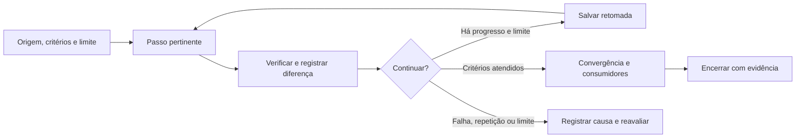

# Ciclos, verificações e condições de parada

Processo 0.1.0: objetivo delimitado → passo pertinente → evidência → decisão de continuar ou encerrar. O mesmo assistente conduz por padrão. Não há executor de sessões novas, agendamento, serviço externo ou expansão automática de escopo.

## Guiado ou contínuo

execution_mode em .kit/project.json aceita guided (padrão) ou continuous. O trabalho declara stop_after=stage ou delivery e allowed_stages. guided entrega o resultado atual e recomenda a próxima passagem; continuous permite ao assistente continuar pelos resultados pertinentes já autorizados, sem exigir confirmação rotineira entre etapas. Nenhum modo obriga cumprir todas as pastas.

Continuidade não elimina perguntas: usar dados existentes, declarar hipótese reversível e perguntar quando a resposta mudar decisão material. Se a resposta for indispensável, salvar próximo passo e pausar; continuar somente trabalho independente. Não fingir entrevistas, aprovação, contratação ou publicação. A permissão para um MVP local não autoriza colocá-lo em produção.

advance-stage registra etapa, motivo e evidências; pause registra razão e preserva resultados. resume exige razão e teto explícitos. Esses helpers não executam etapas: o assistente realiza o trabalho na sessão e persiste a memória. Depois de encerrar a sessão, é necessário pedir retomada ao host; não há daemon, agendamento ou auto-resume portátil.

```powershell
& ./.kit/scripts/work.ps1 -Project . -Action start -Id clarify-registration -Title 'Entrega delimitada' -Origin 'Pedido' -Base 'Versão atual' -Objective 'Resultado verificável' -Criteria 'Critério observável' -StopAfter delivery -Stage research -AllowedStages research,product,experience,engineering,quality,delivery -MaxRounds 8
& ./.kit/scripts/work.ps1 -Project . -Action pause -Reason 'Aguardar informação indispensável'
& ./.kit/scripts/work.ps1 -Project . -Action resume -Reason 'Informação recebida' -MaxRounds 8
```

A condução contínua depende do assistente e das ferramentas do host. Os arquivos preservam estado para uma retomada solicitada; os helpers não são um motor de execução.

## Preparar e retomar

Antes de iniciar, definir origem/base, intenção, não objetivos e critérios observáveis. Ler princípios decididos e fontes responsáveis. Antes de derivar plano, resolver ambiguidades que mudam o comportamento; antes de implementar, confrontar spec/plano/tarefas. Informação impertinente continua desconhecida, sem bloquear trabalho independente.

```powershell
& ./.kit/scripts/work.ps1 -Project . -Action start -Id clarify-registration -Title 'Pergunta delimitada' -Type research -Origin 'Pedido e fonte identificados' -Base 'Versão/data das fontes' -Objective 'Resultado verificável' -Criteria 'Critério observável' -MaxRounds 3
& ./.kit/scripts/work.ps1 -Project . -Action select -Id clarify-registration
& ./.kit/scripts/work.ps1 -Project . -Action check -Phase execute
```

O teto inicial é três rodadas registradas, ajustável conforme o trabalho. Não equivale a orçamento de tokens/custo ou tempo total. Registrar consumo quando disponível e respeitar os limites definidos na sessão; não inventar medição. O helper controla registros/estado, sem iniciar o assistente. Interromper execução por pedido de cancelamento, impedimento real, falha relevante ou limite. Pode continuar outra atividade independente já autorizada.

## Executar, conferir e registrar

Selecionar um passo que pode alterar a resposta ou atender um critério. Registrar resultado real, procedimento/comando, esperado/observado, arquivos/fontes e próximo passo. Não transformar repetição do texto em progresso. Persistir achados e tentativas úteis no artefato responsável antes de retomar.

```powershell
& ./.kit/scripts/work.ps1 -Project . -Action record-round -Result progress -Summary 'Resultado observado e limites' -Evidence 'docs/product/work/clarify-registration/research.md' -MetCriteria C001 -NextStep 'Confrontar a entrega com a intenção'
```

Evidências devem ser arquivos reais no projeto: relatórios podem apontar às fontes externas/comandos. Biblioteca, estado e handoff não demonstram entrega. O helper verifica existência/hash; conteúdo verdadeiro e suficiente depende de inspeção/execução pertinente. Critérios atendidos são declarações rastreáveis do responsável, não certificação automática.

As checagens plan/execute exigem intenção, critérios e fontes declaradas existentes/elaboradas; spec, plano e tarefas separados são opcionais. Um modelo materializado ainda não elaborado bloqueia a checagem quando faz parte do trabalho. Isso não certifica preparo semântico: esclarecer regras, dependências e autorização continua necessário, mesmo quando a informação cabe num único registro.

Em colaboração, indicar -Id nas ações; seleção ativa é compartilhada. Os helpers comparam o hash lido e gravam sob uma trava local curta, exercitada entre processos na mesma sessão Windows. Uma leitura obsoleta recebe conflito e deve reler/reconciliar antes de tentar novamente. Essa proteção não integra edições de conteúdo, não coordena outras sessões/máquinas/escritores e não substitui revisão/Git ou checkouts isolados.

Resultado de rodada: progress, no_progress, blocked ou failed. Repetição das evidências sem novo critério interrompe como no_progress. Se há falha repetida, rever estratégia/alcance. Retomar (resume) exige Reason e MaxRounds explícitos, sem apagar rodadas. Cancelar (cancel) registra Reason em closure. Novo escopo material recebe outro trabalho ligado à base anterior.

## Métodos dentro do ciclo

SDD mantém intenção, plano e tarefas alinhados. Cenários inspirados em BDD concretizam critérios. Usar TDD quando uma regra/contrato/correção possui verificação determinística significativa: escrever o teste, observar falha pela causa prevista, implementar o necessário, observar aprovação e refatorar preservando comportamento. Registrar evidência de Red e Green; planejar testes ou escrevê-los depois não prova TDD.

TDD não é obrigatório para pesquisa, documento simples ou exploração visual descartável. Em código existente, seguir estratégia/convenções e risco; justificar abordagem alternativa quando TDD não for adequado, preservando verificações necessárias. Acessibilidade/UI exige inspeção pertinente além de testes automatizados. Não escrever testes que só repetem a implementação. Não aplicar TDD a validação de demanda.

Princípios ágeis entram como entregas pequenas, feedback, prioridade por valor/risco, capacidade limitada e revisão do rumo. Roadmap organiza apostas, não obrigação de executar tudo. Não impor cerimônias Scrum, equipes fictícias ou estimativas sem dados.

## Consistência e convergência

Antes de implementar, registrar conflitos entre requisitos, plano, tarefas e critérios: requisito sem cobertura, tarefa sem origem, dependência inviável, risco sem tratamento. Corrigir o documento responsável antes de derivar outro contraditório. Revisão pode devolver o trabalho à origem.

Após implementar ou produzir a entrega, confrontar intenção e resultado, incluindo requisitos faltantes, parciais, contraditórios e adições sem requisito. Cada achado indica origem, evidência, impacto e correção/decisão. Criar tarefas corretivas com ID e relação, sem renumerar tarefas antigas ou reduzir silenciosamente o critério. Não reexecutar testes aprovados sem mudança/risco novo que justifique. Uma revisão documental não substitui testes ou pesquisa com pessoas.

```powershell
& ./.kit/scripts/work.ps1 -Project . -Action record-convergence -Result clear -Summary 'Critérios e consumidores conferidos no escopo' -Evidence 'docs/product/work/clarify-registration/convergence.md'
& ./.kit/scripts/work.ps1 -Project . -Action check -Phase complete
& ./.kit/scripts/work.ps1 -Project . -Action complete
```

Concluir exige critérios com evidências atuais e convergência registrada sem lacunas. Evidência alterada exige nova conferência/registro. Nenhum checkbox autoriza publicação, valida mercado ou elimina risco não avaliado. Guardar resultado, limites, pendências e conhecimento atualizado; handoff é resumo derivado.



## Preservação ao encerrar

Enquanto o trabalho está ativo, alteração da evidência invalida o fechamento até haver nova conferência/registro. Na conclusão, o helper captura byte a byte as fontes de prova fora da pasta do trabalho (definições atuais, código etc.) em evidence/baselines, retendo hash e original_path. Assim, a próxima evolução do vigente não invalida a prova daquela versão. O snapshot é material histórico identificado, não a navegação atual ou demonstração de que a versão futura foi testada.

Para trabalho antigo já concluído, usar `-Action preserve-evidence -Id change-id` **antes** de alterar fonte ainda ligada às provas. O helper exige que os hashes antigos ainda confiram; não recupera bytes perdidos, não muda digest para fingir verificação e não reabre critérios/conclusão. Provas dentro do trabalho continuam preservadas em seu destino. Isso protege fontes usadas nos critérios/convergência atuais; não reconstrói versões de todas as rodadas anteriores. É uma escolha local, sem transação multiusuário; snapshots ocupam espaço e não substituem Git/backups.
