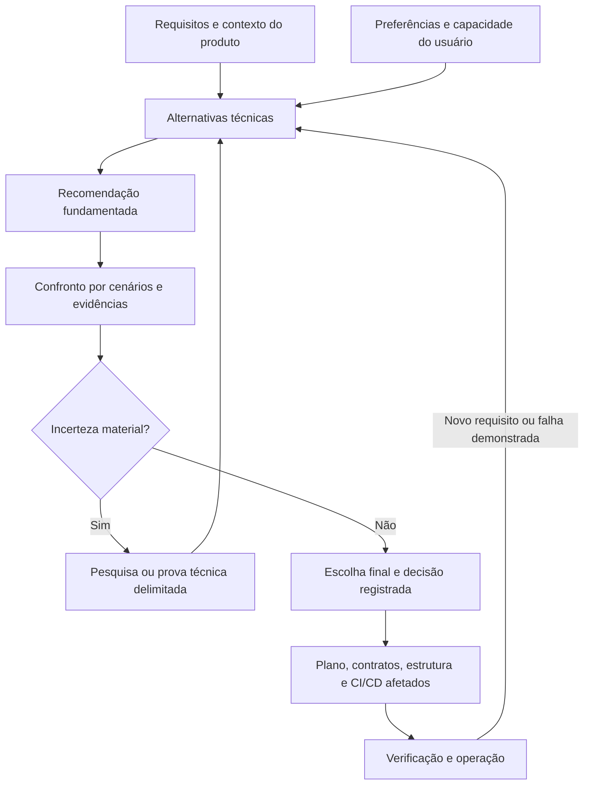

# Recomendação, confronto e decisão técnica

Status: protocolo e modelo; nenhuma tecnologia ou arquitetura aprovada por este arquivo.

## Objetivo e entradas

Traduzir a ideia e o recorte atual em alternativas técnicas justificadas, revisar suas consequências e registrar a decisão do usuário. Aplica-se a arquitetura, tecnologias, organização de frontend/backend, contratos, dados, integrações e CI/CD. O usuário pode escolher uma alternativa diferente da recomendação; justificativa e limitações permanecem visíveis.

Ler requisitos/regras e suas versões, fluxos, dados/audiências, restrições, capacidade e decisões vigentes. Classificar entradas como requisito, preferência, hipótese ou desconhecido. Não transformar uma sugestão tecnológica de rascunho em obrigação. Se o usuário já definiu uma tecnologia, usá-la como restrição explícita e avaliar viabilidade; não reabrir toda a stack sem razão material.

Arquitetura e stack são decisões relacionadas e iterativas: requisitos orientam responsabilidades e alternativas; limitações tecnológicas podem exigir rever o desenho. Não é necessário congelar toda a arquitetura para comparar uma biblioteca.

Conectar a recomendação aos [limites de investimento, manutenção e evolução](capacity-costs-and-evolution.md). Em sistema existente, iniciar pelo [diagnóstico com evidências](existing-project-assessment.md), sem propor reescrita ou infraestrutura nova por padrão.

## Recomendar e confrontar

Transformar qualidades prioritárias em cenários: quem/o que provoca a situação, em qual condição, como o sistema deve responder e qual evidência permitirá conferir a resposta. Metas numéricas dependem de requisito/premissa registrada, não de números inventados.

Comparar opções viáveis, incluindo a mais simples ou manter a solução vigente quando aplicável. Consultar fontes oficiais atuais e registrar versão/data/contexto. Explicar custo total, familiaridade da equipe, manutenção, segurança, compatibilidade, portabilidade e limitações. Não pontuar opções sem justificar critérios/pesos; popularidade não basta.

A revisão confronta a melhor justificativa da proposta. Pode ser realizada pelo mesmo assistente com uma segunda leitura explícita; não alegar independência externa nem criar agentes automaticamente. Confrontar também a alternativa preferida pelo usuário e a recomendação do assistente.

| Área afetada | Pergunta de confronto | Evidência/saída pertinente |
|---|---|---|
| Arquitetura | Cenários, acoplamento, consistência, falhas e recuperação estão coerentes? A complexidade cabe na equipe? | Diagramas/contratos pertinentes, alternativa simples, riscos e ADR |
| Frontend | Navegação, estados de erro/carregamento, acesso, acessibilidade, renderização e estado/dados atendem ao fluxo? | Fluxos/componentes e prova/render/testes conforme a decisão |
| Backend e dados | Quem valida regras e acesso? Há integridade, evolução de contratos/dados, migração e recuperação? | Modelo/contratos e cenários de verificação |
| Organização do código | Fronteiras e dependências são compreensíveis? Monorepo ou repos separados ajudam a entrega real? | Estrutura ligada a responsabilidades, guia de execução e justificativa |
| Integrações | Timeout, retry, idempotência, compatibilidade, credenciais e falhas parciais têm tratamento proporcional? | Contrato, sequência/falhas e verificação pertinente |
| CI/CD | Verificações cobrem riscos da mudança? Artefato/versão são rastreáveis? Segredos/permissões, ambientes, migrações, deploy e recuperação estão coerentes? | Proposta de pipeline e critérios; execução/logs só quando realmente realizada |
| Operação | Custo, observabilidade, backup/restore, suporte e dependências cabem na capacidade? | Hipóteses verificáveis, responsáveis conhecidos e plano de operação |

Selecionar apenas áreas pertinentes. Documentação sustenta uma proposta; não comprova desempenho, isolamento, recuperação ou pipeline funcionando. Usar prova técnica delimitada quando o desconhecido material não puder ser resolvido por fontes.

## Escolha final do usuário

Apresentar recomendação com alternativas e consequências em linguagem acessível. Quando a decisão estiver aberta, oferecer uma escolha concreta e revisável. Se já houver autorização/preferência suficiente, prosseguir dentro dela sem repetir a pergunta.

Registrar separadamente recomendação do assistente e decisão do usuário. Se ele preferir outra opção viável, adaptar o plano e registrar motivo e riscos remanescentes. Se houver conflito demonstrado com requisito essencial, mostrar a incompatibilidade e propor mudança do requisito, mitigação, experimento ou alternativa. Preferência não resolve o conflito por si só; não marcar requisito como atendido nem trocar a escolha silenciosamente.

## Registro por decisão significativa

Pode ser um ADR neste documento ou no plano responsável, sem cópias concorrentes:

- ID/data, pergunta, alcance e estado: proposta, decidida, em experimento ou substituída.
- Requisitos/cenários, fontes/versões, preferências e desconhecidos utilizados.
- Alternativas, comparação e recomendação do assistente com justificativa.
- Confronto: gatilho de falha, consequência, evidência favorável/contrária, mitigação e prova necessária.
- Escolha do usuário e justificativa; sem escolha registrada, permanece proposta.
- Consequências/riscos, critérios de verificação e condição de revisitar.
- Consumidores afetados: arquitetura, tecnologias, UX, segurança, contratos, estrutura, plano/tarefas, CI/CD e operação, conforme alcance.

Retomar quando mudarem requisitos, capacidade, custos, suporte ou houver evidência de falha. Mudanças pequenas podem usar registro curto. Não recriar toda a descoberta nem refazer decisões sem impacto.

## Conexão com o processo

Usar [challenge-assumptions](../../../.agents/skills/challenge-assumptions/SKILL.md) e [revisão crítica](../reviews/critical-review.md), referenciando a decisão técnica. Relacionar pendências/evidências aos arquivos responsáveis. O handoff fornece ao plano técnico a decisão e seus critérios; o contrato local de fatia recebe referências e mantém a fonte responsável de spec/plano/tarefas. Análise de consistência não substitui revisão de arquitetura ou execução de CI/CD.

## Referências e limites

Consulta em 05/10/2026. Roteiro original local, inspirado em [ATAM/SEI](https://www.sei.cmu.edu/library/architecture-tradeoff-analysis-method-collection/) para cenários/risco/conflitos de qualidade, [arc42](https://arc42.org/overview/) para documentação proporcional e [architecture-designer](https://github.com/Jeffallan/claude-skills/blob/main/skills/architecture-designer/SKILL.md) para requisitos, alternativas, ADRs e revisão. A skill upstream é comunitária, não oficial da Anthropic; aproveitamos práticas, sem importar pacote ou exemplos de stack.

Os pilares do [Microsoft Well-Architected](https://learn.microsoft.com/en-us/azure/well-architected/) ajudam a formular perguntas sobre confiabilidade, segurança, custo, operação e desempenho. Usar conceitos pertinentes, sem adotar Azure ou transformar checklist de fornecedor em requisito universal. Este roteiro não equivale a avaliação formal ATAM nem certificação.
