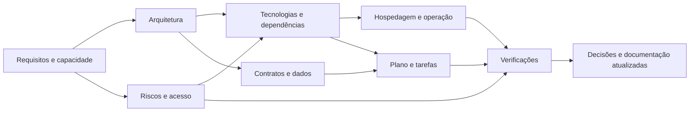
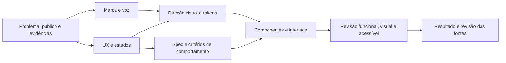

# Diagramas que respondem perguntas

Status: guia; os exemplos abaixo são do processo, não arquitetura implementada de um produto.

| Pergunta | Representação adequada | Documento/consumidor |
|---|---|---|
| Quem usa e onde o sistema se relaciona com outros? | Contexto, referência C4 quando útil | Requisitos/arquitetura |
| Quais componentes guardam/processam informação? | Contêiner/componentes e fluxo | Arquitetura/plano |
| Como uma ação cruza partes e pode falhar? | Sequência, incluindo falha/reenvio relevante | Contratos/testes |
| Quais dados/relações/restrições existem? | Modelo conceitual/ER | Dados/migrações |
| Como pessoa navega e entende estados? | Jornada, fluxo/estados ou wireframe | UX/design/spec |
| Quais fronteiras e dados precisam de proteção? | Fluxo de dados com fronteiras de confiança | Segurança/revisão |
| Como disponibiliza e recupera? | Implantação/ambientes e recuperação | Infra/operação |
| Como tokens/componentes passam ao produto? | Mapa do design system e handoff | Design/engenharia/qualidade |

Cada diagrama informa pergunta, base/versão, legenda e hipóteses; usar nomes do domínio real quando elaborá-lo. Manter IDs/links pertinentes. Não gerar todos por obrigação; Mermaid ajuda na revisão de Markdown, mas não substitui inspeção de wireframes/interfaces quando essa é a pergunta.

## Conexão entre escolhas técnicas

## Conexão do sistema de design

Diagrama sem pergunta ou que apenas repete texto é dispensável. Diagramas desatualizados precisam ser revisados junto com o consumidor da decisão.
